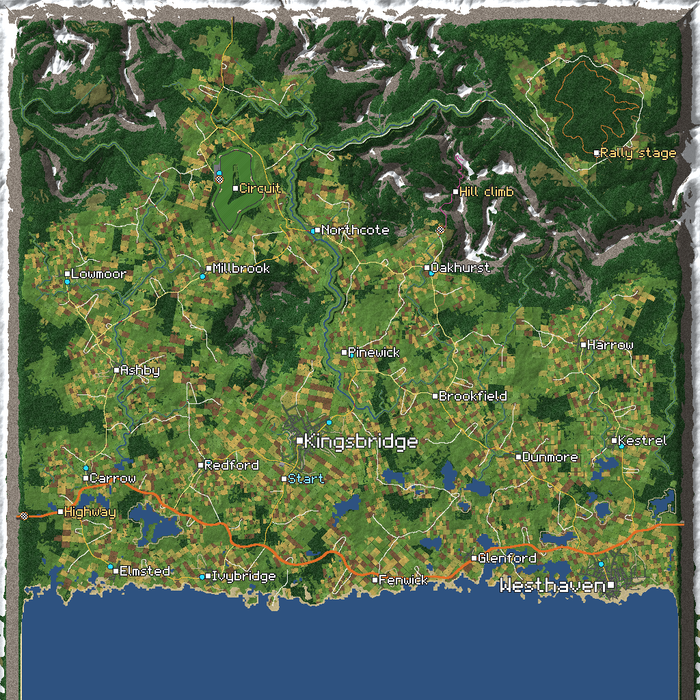

# HalfGripOpenWorld

A [Half Grip](https://store.steampowered.com/app/4163270/) mod: **Open World**, free roam in a 32 km (20 mile) square of country,
generated from a fixed seed (the same for every player) the way real country comes about.

- **Land and water:** a coastal plain and the sea to the south, uplands and mountains to the north; rivers that drain the land to
  the sea, with floodplains, banks and lakes.
- **Places:** a market town (Kingsbridge), villages and about a hundred farms and hamlets, each where people would settle.
- **Roads:** a dual-carriageway trunk road along the coast, main roads between neighbouring places, a mountain pass, town streets,
  country lanes, farm tracks and footpaths, with bridges, verges, sidewalks and tunnels at the world's edge.
- **Buildings:** houses along every street, high-street shops, glass towers in the town centre, village churches, farms, a retail
  park, and filling stations and workshops along the main roads.
- **Parks and trails:** town parks with ponds, paths and benches, a riverside walk, and trails round the lakes.
- **Race courses:** a 2.9 km tarmac circuit with kerbs, gravel traps, pits and grandstands; a 5 km gravel rally stage through the
  upland forest; a 1.5 km hill climb up a mountain valley. Each has a timed solo event (see [Events](#events)).
- **Road signs:** name signs into every town and village, and fingerposts at junctions with the miles to the nearest places by road.
- **Garages:** where the car can be refitted, repaired and refilled mid-race, and made the respawn point (see [Garages](#garages)).
- **Trees and grass:** the Forest map's pines in the woods and hedges, grass and wheat near the car.




It streams in 250 m tiles around the car, and a floating origin keeps the physics as precise 15 km out as at the spawn. It is a source
mod for [HalfGripTools](https://github.com/4l3x4nd3r0/HalfGripTools). Version **0.17.0**, made for game version 0.418 and HalfGripTools 1.0.2 or newer.

**Work in progress.** Street lamps and a far view come next (see [docs/DESIGN.md](docs/DESIGN.md)).

## Install

1. Install BepInEx and HalfGripTools (steps 1 and 2 of the [HalfGripTools README](https://github.com/4l3x4nd3r0/HalfGripTools#install)).
2. Copy the `OpenWorld` folder into `BepInEx\HalfGripMods\` in the game folder.
3. Start the game. `BepInEx\LogOutput.log` should have `Loaded Open World 0.17.0` and `Open World map made from TokyoNeon`.

## Playing it

- **Solo:** set `TestMode = true` in `BepInEx\config\halfgrip.openworld.cfg` and start a run. Every race is then in the Open World.
  The Open World is never dealt on a normal run map, because a free-roam race has no finish line and would end the run.
- **Multiplayer:** with the [Multiplayer mod](https://github.com/4l3x4nd3r0/HalfGripMods), the host picks **OpenWorld** in the room's
  map list. Everyone needs this mod at the same version. The host ends the race from the pause menu.
- You start on the road into Kingsbridge, the main town, just outside it and facing its middle.
- **Reset** (hold R) puts the car back on its wheels where it is, not back at the spawn. A car that ends up in a river, a lake or the
  sea is put back on the nearest road.
- **Wrecked:** the drive goes on. After a few seconds the car is back at the start, repaired (on the first free grid slot, so
  players respawning together do not land on each other), or at the garage you made the respawn point (see [Garages](#garages)). In a Multiplayer room the room's respawn time counts, and an Open World
  race is always played with respawns (a Demolition is played as a race, and "out, watch" as respawn), since it has no finish.
- **No AI rivals**, solo or in a room: the room's AI RIVALS setting is ignored in the Open World.
- **Day and night.** The race starts at an hour of its own (mostly in the day) and the clock goes round: a whole day and night
  takes 40 minutes. The sun rises in the east and sets in the west, the light turns gold as it does, then the moon and a night sky
  come out and the headlights go on. The day's and the night's looks are drawn from the game's weathers each race.
- **Weather.** Storms drift across the country with the wind: it rains in one place and not another, a shower can be seen coming
  (the sky darkens and the fog closes in before the rain) and driven out of, and above the snow line it snows. Roads stay wet for a
  while after a shower, darker and shinier, and grip a little less; they dry over about 10 minutes. Some days are dry, some wet.
  Everything comes from the room's seed and the race clock, so everyone in a room has the same sky and the same storms in the same
  places.

## Garages

A glowing cyan circle marks a garage on the forecourt of every filling station, in every workshop's yard, in the circuit's pit lane,
the rally service area and the hill climb paddock (20 in all); each shows as a cyan dot on MiniMap's map. Stop in a circle and shift
into neutral to open it:

- Every item the game offers by normal means (locked ones and the gun mods' too) can be fitted. Drag an item onto a slot or
  right-click it to fit it; drag it off its slot or right-click it again to take it off. In a Multiplayer room, the items the
  Multiplayer mod bans are not offered.
- **Repair** fills the health, **Refill** the ammo and nitro. Nothing can hurt the car while the garage is open.
- **Respawn here** makes the garage your respawn point: after a wreck the car comes back in its circle, facing out, instead of at
  the start (at the start after all if another car is standing in the circle). Press it again (**Respawn at start**) to go back to
  the start. The bottom right of the window says where a wreck goes. It lasts for that race only: every race starts at the start,
  and it is never saved. In an event a wreck still goes back to the last checkpoint.
- Close it with Close or Esc. Changes last for that race only: nothing is saved, and the next race starts with the loadout picked
  in the menu or the room. Mouse only.

## Events

Each course has a timed event: 3 laps of the circuit from pole, once round the rally stage, and the hill climb from its foot to the
finish below the col. A glowing orange box beside each course marks where to sign on: in the circuit's pit lane past the garages, in
the rally service area and in the hill climb paddock, next to the garage's circle. "EVENT" floats over each box when you are near,
and each one has a chequered disc on the map.

- Drive into the box: a panel like the garage's shows the event, its length, laps, checkpoints and your best time.
- Stop in it and shift into neutral: the car is put on the grid behind the start line and held there while the start lights over
  the line count down (red, amber, both, green; 3, 2, 1, GO). Put it in gear and rev while you wait: it goes on the green.
  The cockpit's board (top right) slides out with the event.
- The clock runs through the checkpoints: an orange gate across the road, lit only while the event runs (the next one and the one
  after; the finish line's is white). The board shows the time, the checkpoints passed and your best; the lap counter beside it the
  lap (on the circuit) or the checkpoint. A missed gate is called out and the clock runs on, but that run sets no best time.
- A wreck puts the car back just past the last gate passed, and the clock runs on. Driving more than about 150 m from the course for
  10 seconds (or teleporting) gives the event up.
- Your best time for each course is kept in `halfgrip.openworld.cfg` under `[Best times]` (never in the game's save); set one to 0
  to start again. A course a new version lays out differently starts with no best time.
- Out of an event the board is tucked into the right edge of the screen. Put the hand over the sliver that shows and it slides out
  with the list of cars in the race (in a Multiplayer room, the players).
- In a Multiplayer room an event is your own time trial: the others do not see it. Events that a room runs together come later.

## Settings

All settings only change your own game. Nothing that shapes the world is a setting, because every player in a room has to drive on
the same ground.

| Section | Key | Default | What it does |
|---|---|---|---|
| Map | `TestMode` | false | Every race you start is in the Open World. |
| Map | `RespawnSeconds` | 3 | Solo: seconds after a wreck before the car is back at the start or the respawn garage (1 to 30). |
| World | `TileRadius` | 5 | Tiles kept loaded around the car (5 is about 1.3 km; the fog ends there). |
| World | `GrassReach` | 2 | Tiles round the car whose grass is drawn (0 turns grass off). |
| World | `ShiftDistance` | 1000 | Metres from the scene's origin before the scene is moved back. |
| Debug | `Teleport` | false | `TeleportKey` (F7) jumps the car to the next key place (the spawn, the towns, the circuit's grid and paddock, the rally stage's start and service area, the hill climb's start and finish, the retail park, the villages, a filling station and a workshop, the mountain pass), Shift+F7 to the one before; the place's name shows at the top of the screen. |
| Debug | `ShowCoords` | false | Shows the world position, origin offset and tile count on screen, and the sky: the time, the rain, cloud and wetness at the car, the grip, the nearest storm. |
| Debug | `WeatherSkip` | false | `WeatherSkipKey` (F8) moves your own sky 5 minutes on (Shift+F8 back): the time of day and the storms. Only your view; in a room you are out of step with the others until the next race. |
| Debug | `VerboseLog` | false | Logs every origin shift and tile timings. |

## Names

Every name the world shows (towns, villages, the race courses) is in one list, `OpenWorld/src/Names.cs`. Change a name there (the
mod is compiled when the game starts, so editing the installed file is enough) and its signs, the labelled map, the teleport's list
and the log all follow: each sign's lettering is drawn from the list when the world is built, and its board is sized to fit. A name
never moves the land or the roads (the first village name simply goes to the best village site), though a longer name makes longer
boards, and a house beside one may move, so everyone in a Multiplayer room still needs the same files. Keep the number of names in
each list as it is (it decides how many villages there are). The lettering has A to Z, a to z, 0 to 9, space and `. , ' - & ( ) / :
! ?`; accented letters are drawn without their accents.

## Map API for other mods

`HalfGripOpenWorld.MapView` (`MapView.cs`) is a public API other mods rely on (the MiniMap mod reads it by reflection, by type and
member name). **Do not rename it or change its members' names or signatures.** All its members are static properties or methods:

| Member | |
|---|---|
| `bool Active` | True while an Open World race is loaded. |
| `double OriginX`, `double OriginZ` | World coordinates of the scene's 0,0: add them to a scene position for a world position. |
| `float TileSize` | 250. Tile (tx, tz) covers world x from `tx * TileSize` to `(tx + 1) * TileSize`, and z the same. |
| `int TilePixels` | 64, the side of a tile's map picture. |
| `bool TryGetTile(int tx, int tz, Color32[] into)` | Copies a loaded tile's map picture into `into` (`TilePixels` squared, rows from the south edge, x running east); false if the tile isn't loaded. Main thread only. |
| `int Version` | Goes up whenever a tile's map picture is added or removed. |

A tile's map picture is its land use with water and roads painted in, in the colours of `docs/world.png` (roads at least 2 pixels
wide), car parks and the circuit in greys, and each garage (or group of garages within 250 units) a cyan disc in a dark ring about
100 units across, over everything. It is made on a worker thread and kept only while the tile is loaded. Display only.
## Checking a change

Compile against the game without starting it (Linux or macOS, or WSL; the game folder can be the HalfGripRefs repo's `game/`):

```
dotnet build <HalfGripTools>/HalfGripTools/HalfGripTools.csproj -c Release -p:GameDir=<game folder>
tools/check.sh <game folder> <HalfGripTools>/dist/BepInEx/plugins/HalfGripTools/HalfGripTools.dll
```

On Windows, HalfGripTools' own `tools\check-mods.ps1 -ModsPath <this repo> -Mod OpenWorld -GameDir <game folder>` does the same.

`tools/preview` checks the world generator and draws a map (as `docs/world.png`, with names as `docs/world-labels.png`);
`tools/meshcheck` builds the world against Unity's own types and exits 1 if any check fails (road surfaces, bridges, water edges,
buildings, the courses, signs, garages; name checks after `--` to run only those):

```
dotnet run -c Release --project tools/preview -- world.ppm 1024
dotnet run -c Release --project tools/preview -- town.ppm 640 -2600 -6800 6000    # west x, north z, side
dotnet run -c Release --project tools/meshcheck -p:GameDir=<game folder>
dotnet run -c Release --project tools/stormview -- storms.ppm 12345 10    # room seed, minutes between pictures
```

`tools/stormview` checks the storms (how much of the land is under rain over 20 room seeds, that a seed always gives the same
weather, what a sample costs) and draws the world at six times for one seed.

The in-game test checklist is in [docs/TESTING.md](docs/TESTING.md); how the generator and the code work, in [docs/DESIGN.md](docs/DESIGN.md).
