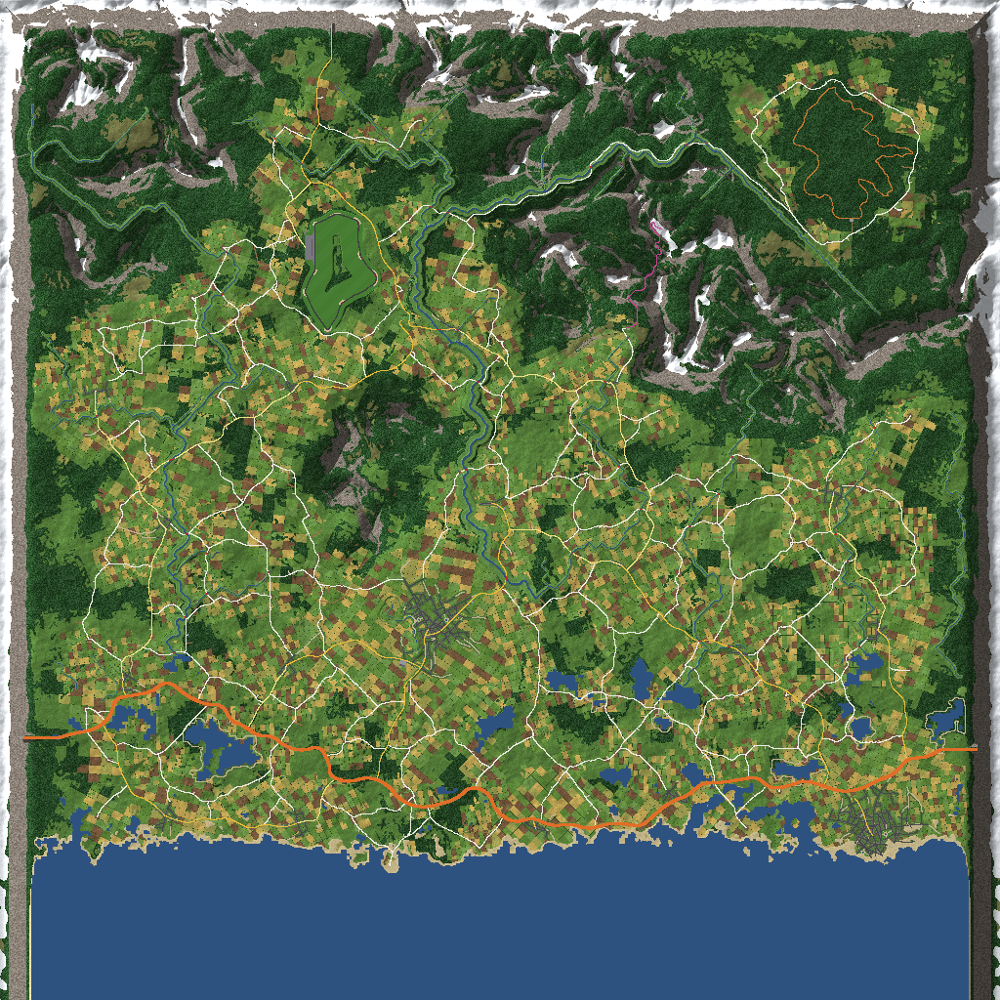
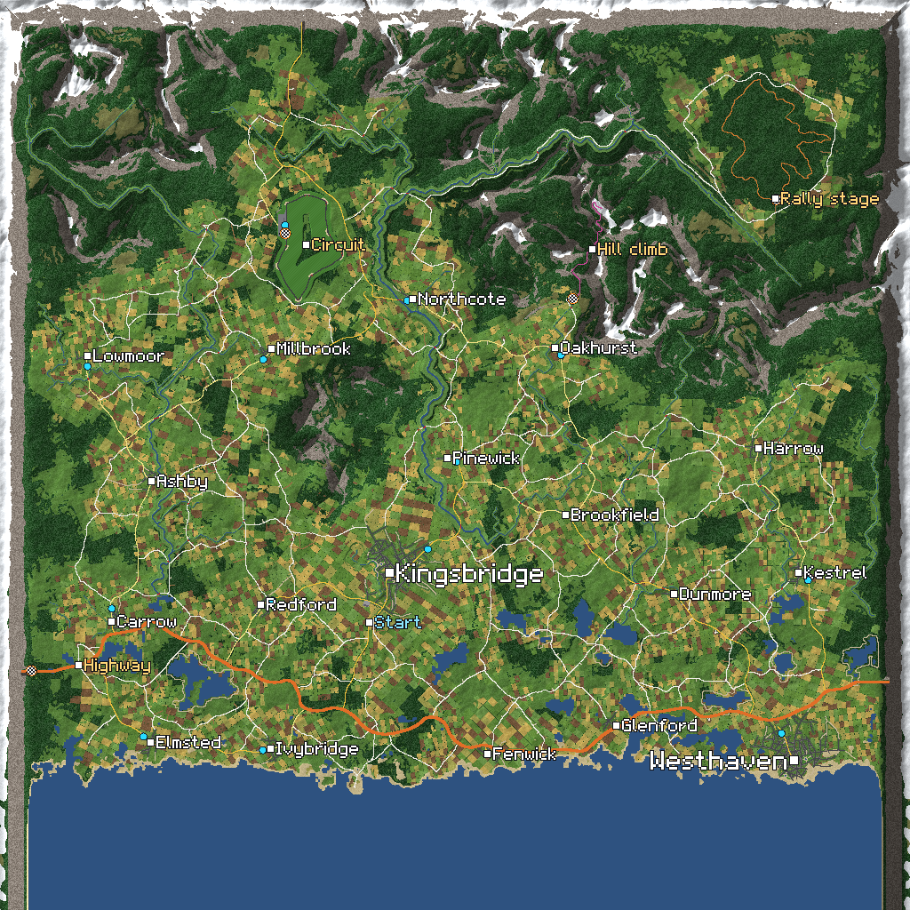

# HalfGripOpenWorld

A [Half Grip](https://store.steampowered.com/app/4163270/) mod: **Open World**, free roam in a 32 km (20 mile) square of country,
generated from a fixed seed (the same for every player) the way real country comes about.

- **Land and water:** a coastal plain and the sea to the south, uplands and mountains to the north; rivers that drain the land to
  the sea, with floodplains, banks and lakes.
- **Places:** two towns (Kingsbridge, the market town, and Westhaven by the sea), villages and about a hundred farms and hamlets,
  each where people would settle. The towns are laid out as English market towns grew, ring by ring: a market place on the high
  street, the old town's back lanes, patches of terraced streets each at its own angle, a ring road, crescents and closes past it,
  and Westhaven's seafront; streets meet their roads square.
- **Roads:** a dual-carriageway trunk road along the coast, main roads between neighbouring places, a mountain pass, town streets,
  country lanes joined up into a web with hardly a dead end (through woods, over streams on covered timber bridges), farms and
  roadside houses on gravel drives with a mailbox at the road, farm tracks and footpaths, with bridges, verges, sidewalks and
  tunnels at the world's edge.
- **Buildings:** houses along every street, high-street shops, a market place with its cross, stalls and shops round it in each
  town, glass towers in the town centre, village churches, farms, a retail
  park, and filling stations and workshops along the main roads. Houses in brick, stock brick, stone, whitewash and coloured
  render, with sash or casement windows a whole storey each, front doors, plinths taking up the slope, gabled or hipped roofs of
  slate, clay tiles or pantiles (thatch on village cottages) with real thickness, fascias and chimneys, and wings at the back.
- **Parks and trails:** town parks with ponds, paths and benches, a riverside walk, and trails round the lakes.
- **Race courses:** a 2.9 km tarmac circuit with kerbs, gravel traps, pits and grandstands; a 5 km gravel rally stage through the
  upland forest; a 1.5 km hill climb up a mountain valley. Each has a timed solo event (see [Events](#events)), and so has the
  trunk road: a 10 km checkpoint race along it from the west edge to the east.
- **Road signs:** name signs into every town and village, and fingerposts at junctions with the miles to the nearest places by road.
- **Garages:** where the car can be refitted, repaired and refilled mid-race, and made the respawn point (see [Garages](#garages)).
- **Trees and grass:** the Forest map's pines in the woods and hedges, grass and wheat near the car.
- **Far view:** past the loaded ground the whole country is drawn at low detail (its land use, water, woods standing up, the main
  roads), so the mountains, the coast and the towns are seen to the horizon on a clear day; past where it is drawn, the land is
  painted into the sky, so on the clearest days you see across the whole world, the far mountains hazy on the horizon.





It streams in 250 m tiles around the car, and a floating origin keeps the physics as precise 15 km out as at the spawn. It is a source
mod for [HalfGripTools](https://github.com/4l3x4nd3r0/HalfGripTools). Version **0.26.0**, made for game version 0.418 and HalfGripTools 1.0.6 or newer.

**Work in progress.** Street lamps come next (see [docs/DESIGN.md](docs/DESIGN.md)).

## Install

You need Windows and the game on Steam. The mod launcher from [HalfGripMods](https://github.com/4l3x4nd3r0/HalfGripMods) does
everything: it installs BepInEx and HalfGripTools, and adds this mod from its GitHub link.

1. Download `HalfGrip-Mods-Installer.exe` from the [HalfGripMods releases](https://github.com/4l3x4nd3r0/HalfGripMods/releases)
   (the newest release called "installer") and double-click it. If Windows says "Windows protected your PC", press **More info**,
   then **Run anyway**.
2. Close the game, then press **INSTALL ALL** (BepInEx, HalfGripTools and the official mods). To leave out the official mods,
   press **INSTALL** on just the BepInEx and HalfGripTools cards.
3. Press **+ ADD**, paste `https://github.com/htubdawg/HalfGripOpenWorld` and press **ADD**. Then press **INSTALL** on the Open
   World card.
4. Start the game from Steam.

To update, open the launcher again: Open World gets an **UPDATE** button when a new version is out (everyone in a Multiplayer room
needs the same version). To stop playing it, switch it off in the game's mod manager.

If something does not work, `BepInEx\LogOutput.log` in the game folder should have `Loaded Open World 0.26.0` and
`Open World map made from TokyoNeon`.

## Playing it

- **Solo:** set `TestMode = true` in `BepInEx\config\halfgrip.openworld.cfg` and start a run. Every race is then in the Open World.
  The Open World is never dealt on a normal run map, because a free-roam race has no finish line and would end the run.
- **Multiplayer:** with the [Multiplayer mod](https://github.com/4l3x4nd3r0/HalfGripMods), the host picks **OpenWorld** in the room's
  map list. Everyone needs this mod at the same version. The host ends the race from the pause menu.
- You start on the road into Kingsbridge, the main town, just outside it and facing its middle.
- **Reset** (hold R) puts the car back on its wheels, not back at the spawn: on the nearest road if there is one within about 75 m
  (in the right-hand lane, facing the way you were going); further out, on the nearest clear, flat, dry spot round the car, clear of
  trees and buildings (where it is, if that is clear), never to a road far off: deep in the woods it stays in the woods. On a road, a
  farm track, the circuit or the rally stage it stays where it is; in an event's race it is never moved onto another road. A car that
  ends up in a river, a lake or the sea is put back on dry land the same way.
- **Wrecked:** the drive goes on. After a few seconds the car is back at the start, repaired (on the first free grid slot, so
  players respawning together do not land on each other), or at the garage you made the respawn point (see [Garages](#garages)). In a Multiplayer room the room's respawn time counts, and an Open World
  race is always played with respawns (a Demolition is played as a race, and "out, watch" as respawn), since it has no finish.
- **No AI rivals**, solo or in a room: the room's AI RIVALS setting is ignored in the Open World.
- **Day and night.** The race starts at an hour of its own (mostly in the day) and the clock goes round: a whole day and night
  takes 40 minutes. The sky is painted in code: the sun's disc rises in the east and sets in the west, where its light comes from,
  the sky goes gold and red round it and the light with it, then the moon comes up opposite, the stars come out and turn about the
  pole, and the headlights go on. Clouds drift over with the storms' wind, more on a wet day, the whole sky under a storm. The
  colours of the light and a little haze in the sky are drawn from the game's weathers each race.
- **Weather.** Storms drift across the country with the wind: it rains in one place and not another, a shower can be seen coming
  (its dark cloud on the horizon with grey rain hanging under it, then overhead, the fog closing in before the rain) and driven out of, and above the snow line it snows. Roads stay wet for a
  while after a shower, darker and shinier, and grip a little less; they dry over about 10 minutes. Some days are dry, some wet.
  Everything comes from the room's seed and the race clock, so everyone in a room has the same sky and the same storms in the same
  places.
- **How far you see** is the weather's: far on a clear day (some days are hazier than others), less at night and under cloud, and
  only a few hundred metres in a downpour.

## Garages

A glowing cyan circle marks a garage on the forecourt of every filling station, in every workshop's yard, in the circuit's pit lane,
the rally service area and the hill climb paddock (20 in all); each shows as a cyan dot on MiniMap's map. Stop in a circle, shift
into neutral and let go of the shifter to open it:

- Every item the game offers by normal means (locked ones and the gun mods' too) can be fitted. Drag an item onto a slot or
  right-click it to fit it; drag it off its slot or right-click it again to take it off. In a Multiplayer room, the items the
  Multiplayer mod bans are not offered.
- **Repair** fills the health, **Refill** the ammo and nitro. Nothing can hurt the car while the garage is open.
- **Respawn here** makes the garage your respawn point: after a wreck the car comes back in its circle, facing out, instead of at
  the start (at the start after all if another car is standing in the circle). Press it again (**Respawn at start**) to go back to
  the start. The bottom right of the window says where a wreck goes. It lasts for that race only: every race starts at the start,
  and it is never saved. In an event a wreck still goes back to the last checkpoint.
- Close it with Close or Esc. Changes last for that race only: nothing is saved, and the next race starts with the loadout picked
  in the menu or the room. Mouse only.

## Events

Each course has a timed event: 3 laps of the circuit from pole, once round the rally stage, the hill climb from its foot to the
finish below the col, and the **highway**: one way along the trunk road, from just inside the west edge's tunnel to just short of the
east edge's, 10 km and 33 checkpoints. A glowing orange box beside each course marks where to sign on: in the circuit's pit lane past
the garages, in the rally service area and in the hill climb paddock, next to the garage's circle; for the highway, on the westbound
carriageway at the west end, between the start line and the tunnel (drive west along the trunk road to the end of the world and
stop in it; you are put on the grid on the eastbound side, facing east). "EVENT" floats over each box when you are near, and each
one has a chequered disc on the map.

- Drive into the box: a line shows the event, its length, laps, checkpoints and your best time, and what is on there
  ("RACE ON", or how many lobbies are waiting; "EVENT" over the box says the same).
- Stop in it, shift into neutral and let go of the shifter: the course's **panel** opens (the cursor is freed, as in a garage). It
  lists the course's lobbies (Host, entrants, weapon rules, state) with **Join**, and **Create** a lobby with its rules: **Guns**
  on or off, **Melee** on or off (the rules are enforced in a later version). Alone (no Multiplayer room) the button is **Start**:
  a lobby of one is a solo run, and it starts at once.
- Joining or creating moves the car just clear of the box to a waiting spot (one for every grid slot: 12 at the circuit and the highway, 8 at the rally stage and the hill climb), so the box is
  free for the next player; if every spot is taken (several lobbies waiting at once) the car stays where it is. The room is told
  when a lobby opens. While in a lobby a **strip** under the cockpit's board shows the course, the Host, the entrants, the rules and
  the state, with **Start** (the Host's) and **Leave**: point the hand at a button and grab, as with the cockpit's levers (the hand is drawn
  over the strip). The board
  lists the lobby's entrants.
- **One race per course at a time:** the first Start takes the course; another lobby's Start reads "Race on" until its results are
  done. Races on different courses run at the same time, and the rest of the room roams.
- On the Start every entrant's car is put on its own grid slot (in the order they joined: two abreast on the circuit and the highway,
  single file on the rally stage and the hill climb) and held there while the start lights over the line count down to the same
  moment for everybody (red, amber, both, green; 3, 2, 1, GO). Put it in gear and rev while you wait: it goes on the green.
- The clock runs from your own green through the checkpoints: an orange gate across the road, lit only while you race (the next one
  and the one after; the finish line's is white). The board shows the time, your place among the entrants, the checkpoints passed and
  the time left (your best, alone); the lap counter beside it the lap (on the circuit) or the checkpoint. A missed gate is called
  out and the clock runs on, but that run sets no best time and ranks after the clean finishes.
- A wreck puts the car back just past the last gate passed (on the highway, on the eastbound carriageway), and the clock runs on.
  Driving more than about 150 m from the course for 10 seconds (or teleporting) puts you out of the race and out of the lobby:
  if you were its Host, the next player in takes it over; if nobody is left, it closes and the course is free.
- The race ends when everybody has finished or is out, 45 seconds after the first finisher, or at the course's time limit (circuit
  13:00, rally stage 7:30, hill climb 2:30, highway 15:30); those still running are out (DNF). The results stand on the board for 15
  seconds, then the course is free and the lobby waits again. The strip is hidden from the Start until then, so only the board
  is on the screen while you race.
- Your best time for each course is kept in `halfgrip.openworld.cfg` under `[Best times]` (never in the game's save); set one to 0
  to start again. A course a new version lays out differently starts with no best time.
- Out of a lobby the board is tucked into the right edge of the screen. Put the hand over the sliver that shows and it slides out
  with the list of cars in the race (in a Multiplayer room, the players).

## Settings

All settings only change your own game. Nothing that shapes the world is a setting, because every player in a room has to drive on
the same ground.

| Section | Key | Default | What it does |
|---|---|---|---|
| Map | `TestMode` | false | Every race you start is in the Open World. |
| Map | `RespawnSeconds` | 3 | Solo: seconds after a wreck before the car is back at the start or the respawn garage (1 to 30). |
| World | `TileRadius` | 5 | Tiles kept loaded around the car (5 is about 1.3 km; past them the far view, or with it off the fog's end). |
| World | `GrassReach` | 2 | Tiles round the car whose grass is drawn (0 turns grass off). |
| World | `TreeShadowReach` | 2 | Tiles round the car whose trees cast shadows; further off they are drawn without (less costs less frame time in the woods). |
| World | `FarView` | true | Draws the whole world at low detail past the loaded tiles, and lets you see as far as the weather allows. Off, the fog ends where the tiles end, as before 0.19.0. |
| World | `FarViewDistance` | 14000 | With `FarView` on, how far the low-detail world is drawn, in game units (4000 to 20000; the world is 32000 across). Past it `FarSkyline` paints the land into the sky; with that off, the furthest you see on the clearest day. Less costs less frame time. |
| World | `FarSkyline` | true | With `FarView` on, paints the land past `FarViewDistance` into the sky, so on a clear day you see across the whole world (to 40000; the weather brings it in) and the fog no longer closes at the far view's edge. Off, it does, as before 0.20.0. |
| World | `ShiftDistance` | 1000 | Metres from the scene's origin before the scene is moved back. |
| Debug | `Teleport` | false | The Teleport key (F7, rebind it in Settings > Controls) jumps the car to the next key place (the spawn, the towns, their market places, the circuit's grid and paddock, the rally stage's start and service area, the hill climb's start and finish, the highway's start, the retail park, the villages, a filling station and a workshop, the mountain pass), Shift+F7 to the one before; the place's name shows at the top of the screen. |
| Debug | `ShowCoords` | false | Shows the world position, origin offset and tile count on screen, and the sky: the time, the rain, cloud and wetness at the car, the grip, the nearest storm; with the far view, its chunks drawn, the fog's reach and how far the camera draws. |
| Debug | `WeatherSkip` | false | The Weather skip key (F5, rebind it in Settings > Controls) moves your own sky 5 minutes on (Shift with it back), and the Weather fast key (F2) turns a 10x speed for it on and off: the time of day and the storms. Only your view; in a room you are out of step with the others until the next race. |
| Debug | `VerboseLog` | false | Logs every origin shift and tile timings. |

## Names

Every name the world shows (towns, villages, the race courses) is in one list, `OpenWorld/src/Names.cs`. Change a name there (the
mod is compiled when the game starts, so editing the installed file is enough) and its signs, the labelled map, the teleport's list
and the log all follow: each sign's lettering is drawn from the list when the world is built, and its board is sized to fit. A name
never moves the land or the roads (the first village name simply goes to the best village site), though a longer name makes longer
boards, and a house beside one may move, so everyone in a Multiplayer room still needs the same files. Keep the number of names in
each list as it is (it decides how many villages there are). The lettering has A to Z, a to z, 0 to 9, space and `. , ' - & ( ) / :
! ?`; accented letters are drawn without their accents.

## Map API for other mods

`HalfGripOpenWorld.MapView` (`MapView.cs`) is a public API other mods rely on (the MiniMap mod reads it by reflection, by type and
member name). **Do not rename it or change its members' names or signatures.** All its members are static properties or methods:

| Member | |
|---|---|
| `bool Active` | True while an Open World race is loaded. |
| `double OriginX`, `double OriginZ` | World coordinates of the scene's 0,0: add them to a scene position for a world position. |
| `float TileSize` | 250. Tile (tx, tz) covers world x from `tx * TileSize` to `(tx + 1) * TileSize`, and z the same. |
| `int TilePixels` | 64, the side of a tile's map picture. |
| `bool TryGetTile(int tx, int tz, Color32[] into)` | Copies a loaded tile's map picture into `into` (`TilePixels` squared, rows from the south edge, x running east); false if the tile isn't loaded. Main thread only. |
| `int Version` | Goes up whenever a tile's map picture is added or removed. |

A tile's map picture is its land use with water and roads painted in, in the colours of `docs/world.png` (roads at least 2 pixels
wide), car parks and the circuit in greys, and each garage (or group of garages within 250 units) a cyan disc in a dark ring about
100 units across, over everything. It is made on a worker thread and kept only while the tile is loaded. Display only.
## Weather API for other mods

`HalfGripOpenWorld.WeatherView` (`WeatherView.cs`, since 0.24.0; asked for by the Slap Pack mod's windscreen) is the weather at the
player's car, read by reflection the same way as `MapView`. **Do not rename it or change its members' names or signatures**; if a
member's meaning ever changes, `ApiVersion` goes up. All static, all main thread, nothing worked out or allocated on a read:

| Member | |
|---|---|
| `int ApiVersion` | 1. |
| `bool Active` | True while an Open World race is loaded and its sky is running. False before the sky starts, on a scene change, after it stopped on an error, and outside the Open World; then every value reads 0. |
| `float Rain`, `float Snow` | What falls at the car, 0 to 1 each, `Rain + Snow` at most 1 (both above 0 is sleet). Eased, after the cut-off under which nothing falls, split by height round the day's snow line; independent of the particles' graphics budget. |
| `Vector3 Wind` | The wind the storms drift on, in world units a second, the way the air moves: x east, z north, y 0. About 4 to 11 (a car is about 14 long), fixed for a race. The floating origin moves only positions, so it is the same in scene coordinates. |
| `float Cloud` | Cloud over the car, 0 to 1 (comes before a storm and stays after it). |
| `float Wetness` | How wet the road is at the car, 0 to 1 (stays wet after a shower, then dries). |
| `float Hour` | Time of day, 0 to 24. |
| `bool TryGetLocalWeather(out float rain, out float snow, out Vector3 wind)` | `Rain`, `Snow` and `Wind` in one call; false and all 0 when not `Active`. Plain parameter types, so it can be bound to a delegate of the reader's own and polled each frame. |

## Checking a change

Compile against the game without starting it (Linux or macOS, or WSL; the game folder can be the HalfGripRefs repo's `game/`):

```
dotnet build <HalfGripTools>/HalfGripTools/HalfGripTools.csproj -c Release -p:GameDir=<game folder>
tools/check.sh <game folder> <HalfGripTools>/dist/BepInEx/plugins/HalfGripTools/HalfGripTools.dll
```

On Windows, HalfGripTools' own `tools\check-mods.ps1 -ModsPath <this repo> -Mod OpenWorld -GameDir <game folder>` does the same.

`tools/preview` checks the world generator and draws a map (as `docs/world.png`, and with the garages' and events' marks and the
names as `docs/world-labels.png`);
`tools/meshcheck` builds the world against Unity's own types and exits 1 if any check fails (road surfaces, bridges, water edges,
buildings, the courses, signs, garages, the far view meeting the tiles; name checks after `--` to run only those):

```
dotnet run -c Release --project tools/preview -- world.ppm 1024
dotnet run -c Release --project tools/preview -- town.ppm 640 -2600 -6800 6000    # west x, north z, side
dotnet run -c Release --project tools/meshcheck -p:GameDir=<game folder>
dotnet run -c Release --project tools/stormview -- storms.ppm 12345 10    # room seed, minutes between pictures
dotnet run -c Release --project tools/skyview -- sky.ppm 12345    # room seed
dotnet run -c Release --project tools/farview -- farview.ppm 14000    # clear-day reach
dotnet run -c Release --project tools/jview -- at junction.ppm -10708 -10113 100    # world x, z, span
dotnet run -c Release --project tools/eventsim -- 1    # seed for the pretend network's delays
```

`tools/stormview` checks the storms (how much of the land is under rain over 20 room seeds, that a seed always gives the same
weather, what a sample costs) and draws the world at six times for one seed. `tools/skyview` checks the painted sky (the sun's disc
where its light comes from, the horizon the fog's colour, storms seen from afar toward them and nowhere else, a seed always the same
sky, what a frame costs) and draws it at ten times of day and weathers (as `docs/sky.png`). `tools/farview` builds the far view's
low-detail world (its time, memory, repeatability) and the land painted past it into the sky (that it stands where the far view drawn
to the fog's end would, its cost, a storm's rain in front of it), and draws its picture and three views over the country, each drawn
to the fog's end and as the game shows it (as `docs/farview.png`). `tools/jview` draws the tiles' road meshes from above
round a point, a list of points, random junctions or dead ends, or every hub, with ground showing in a mouth, surfaces poking
through and steps marked; it also lists the roads near a point and the places (its modes are at the top of its `Program.cs`).
`tools/eventsim` drives the events' lobbies in a room (`EventRoom.cs`) on pretend machines over a pretend network with delays:
joins, leaves, the Host leaving, two creates and two Starts at once, races to the finish, the cut-off, the time limit, a player
leaving the room mid-race, a late joiner, the weapon rules and twenty players at random, checking every machine agrees with the
arbiter.

The in-game test checklist is in [docs/TESTING.md](docs/TESTING.md); how the generator and the code work, in [docs/DESIGN.md](docs/DESIGN.md).
