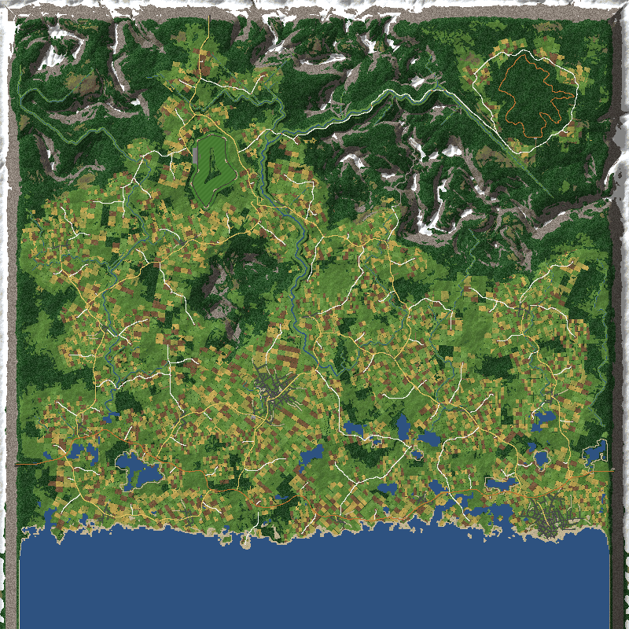
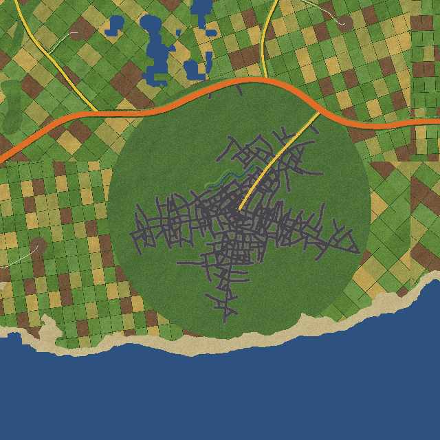

# Design notes

## Why 32 km needs a floating origin

Unity positions are 32-bit floats. The step between representable positions grows with distance from 0,0:

| Distance | Step | Effect on a car |
|---|---|---|
| 2 km | 0.12 mm | none |
| 5 km | 0.5 mm | none |
| 10 km | 1 mm | suspension and camera jitter begins |
| 16 km (the world's edge, from its centre) | 1 mm | jitter |
| 20 km and beyond | 2 mm and more | visible wobble, unstable contacts |

So the physics must never run far from 0,0. `Origin` moves the whole scene back by whole tiles when the car passes `ShiftDistance`,
and keeps the true position as a double offset. Only x and z move.

Shrinking the car instead does not help: precision relative to the car's own size is what matters, so a half-size car at 5 km is
like a full-size car at 10 km, and its handling would all need retuning.

## What moves on a shift

Transforms of every scene root (not screen-space canvases), then `Physics.SyncTransforms`.

**Except the cockpit.** The game draws the cockpit (dashboard, hand, guns, shifter, mirror) as a separate rig on the `INTERIOR` layer
that stands still near 0,0 and is seen by its own `InteriorCamera`; only the car outside moves. The rig shares a root (`Player`) with
the car, so after the roots move, the top of every `INTERIOR` subtree is put back, and the cockpit's particles, trails and bodies are
left alone. The interior's post-processing volume (`ENVIROMENT/Weather/InteriorVolume`) is on that layer too. 0.1.0 moved the
cockpit with the world, and after a few shifts the hand and controls shook with float error. Interpolated rigidbodies have interpolation
switched off for two frames so they do not visibly slide. World-space particles, trail renderers and world-space line renderers are
moved point by point.

Positions the game keeps in fields (from a decompile of 0.418; every `Vector3`, `Vector3[]` and `List<Vector3>` field was checked, and
those holding world positions rather than offsets or directions are listed):

| Class | Field | Notes |
|---|---|---|
| `PathManager` | `sampledPoints`, `kdTree`, `laneSolves[].points` | the tree is rebuilt from the moved samples; `lanes` are offsets and heights, unchanged |
| `LapManager` | `lapDrivenFrom`, `projectedPathIndices` | |
| `TimeRewinder` | `frames[].pos` | the rewind item's recording |
| `RoadPickup` | `restPosition` | |
| `WheatTrampler` | `previousPosition` | on every car |
| `horizontalChicken` | `startPoint` | |
| `EnemyController` | `targetPoint` | AI |
| `FreeFlightCamera` | `targetPosition`, `homePosition` | debug camera |
| `WaypointsManager` | `processedWaypoints` | |
| `TrainPath` | `sampledPoints`, `lastPositions` | Tokyo only |
| `PlayerResetLogic` | `lowestOf` | a reference to `sampledPoints`; heights only, unchanged |
| Multiplayer `RemoteCar` | `position`, `AimPoint` | moved by `MultiplayerLink` |

Not yet handled: the Multiplayer mod's rocket ghosts keep their own last state; a rocket in flight during a shift may jump once.

## Multiplayer

The Multiplayer mod is not changed. Every position goes through its `W.Vec` / `R.Vec` (packet writer and reader), so those are
patched: a position is turned into world coordinates as it is written and back into this player's scene coordinates as it is read.
Which `Vec()` in each message is a position (protocol 7):

| Message | Vec()s | Positions |
|---|---|---|
| Car | position, velocity, aim point (when a gun is raised) | even |
| Respawned | position | even |
| AiState | (position, velocity) per AI car | even |
| Rocket | (position, velocity) per rocket | even |
| RocketEnd | position | even |
| Shot | landing points | all |

At hook time the message numbers are checked against the Multiplayer mod's `Msg` names; on a mismatch nothing is patched and a warning
is logged. Floats are good to about 1 mm at 16 km, which is plenty for drawing another car (only local physics needs better). Remote
cars are kinematic stand-ins, so one over ground that is not loaded on this machine floats; it does not fall.

## World

Units are game units: a car is about 14 long and a lane 11, about 3.3 units to a real metre, so the world is about 10 km across at car
scale (80 km² of land) and takes about 8 minutes to cross at 120 on the dash. Everything is sized to that: a real 10 km square of
lowland country holds about one small market town, a dozen or so villages and a hundred farms and hamlets, and a trunk road passing
through rather than a motorway between two cities. The generator is built in the order real country forms, each stage on the one
before, and is checked against real figures with `tools/preview`.

The ideas come from the procedural-generation literature: Parish and Müller, *Procedural Modeling of Cities* (2001) for growing
streets under local rules; Galin et al., *Procedural Generation of Roads* (2010) and *Authoring Hierarchical Road Networks* (2011) for
routing by weighted shortest path, a hierarchy of road classes and roads that share the way; Barnes et al.'s priority flood (2014) for
drainage; and central place theory and rank-size for settlements.

1. **Land** (`WorldGen.Natural`): a regional trend from the sea in the south (the coast about 5 km in from the edge, wandering) up to
   uplands in the north; gradient-noise lowland swells (growing inland); domain-warped ridged mountain ranges where a slow mask allows,
   mostly in the north; hills and bumps; a wall of mountains along the north, west and east edges.
2. **Rivers and lakes** (`Rivers`): on a 100-unit grid, water is routed over the land plus a gentle noise swell (pure steepest descent
   on smooth noise runs in straight parallel lines; the swell makes streams wander and gather) by a priority flood from the sea, so every
   cell drains to the sea and hollows fill to their spill point. Catchments (cells draining through) of 700 or more are streams; each
   is traced to the sea or to a bigger river, smoothed, given meanders scaled by its size, a width and floodplain from its catchment, and
   a water level a unit under the lowest land across both banks (as cut by the rivers before it, longest first), smoothed but never
   above that, only falling downstream, and held up to the river a tributary joins (never over its own banks). They cut a rounded
   channel whose edge rises over 5 units, a floodplain just above the water and 1-in-3 banks into the land. The nearest river shapes
   the ground; another river, or another loop of the same one, cuts it only through a 1-in-1 bank rising from the nearest. Rivers
   only lower the land, except that a place's levelling never sinks a floodplain, and a bank up to 10 is raised beside the water
   where the ground would be under it. The water surface is drawn 9 past the channel, under the ground. Lakes: a second flood over the real land finds the
   hollows; the eight biggest hold a lake in their deepest part (up to 6 above the floor).
3. **Places** (`Places`): every spot on a 200-unit grid is scored: flatness, a river within 1.5 km but out of its floodplain, the coast
   within 4 km, low ground, no mountains. Taken best first: towns (up to 2, 11 km apart, within 75% of the best score), villages (4.2 km
   apart), then farms and hamlets on their own score (flat, water within reach, height matters little, so they reach the uplands; 1.5
   km apart). The land under each place is softened towards its level, keeping some relief (45% in a town, none in a farmyard).
4. **Roads** (`Network`), in order of importance:
   - the trunk road (dual carriageway, 66 wide, 5%) from the lowest open point on the west edge near the coast to the east, paying to
     go through a town (so it bypasses them), and carried into tunnels in the edge walls; each town joined to it by a main road;
   - main and minor roads on the **Gabriel graph** of the towns, villages and a gate on the north edge (the lowest point, a pass): two
     places are linked if no other place is inside the circle between them, which matches real inter-place networks far better than a
     tree. Links are taken in order of **gravity** (population x population / distance squared); the strongest third (and the pass
     road) are main roads (28 wide, 7%), the rest minor (24, 9%);
   - streets grown in each town and village (below);
   - a lane (15 wide, single track, 11%) from each farm to the nearest road, and some between neighbouring farms;
   - farm tracks (10 wide, dirt, 14%) branching off lanes and minor roads, and footpaths (5 wide, gravel, 18%) walked on from the
     dead ends of town and village streets (most of them) until they meet a road or track or have gone 250 to 700: a shallow bed
     (0.3) pressed into the ground, flat 3 past their soft edges (2, 1.5) so none of the ground's 5-unit triangles rises into them
     (where two beds overlap the lowest is taken), and a ribbon of their own 0.15 over it (a path's 0.02 lower, so one ending on a
     track does not flicker) with a fine texture (4 pixels a unit across: two tyre ruts and a grass strip; gravel), soft edges down
     to the ground, and dirt grip. They meet roads under the road's surface, so they need no junction cuts. (Until 0.6.0 tracks
     were painted into the ground texture, a pixel to 2 units: too blocky.)
   - paved roads in towns and villages (streets, main roads) have a sidewalk instead of the gravel verge: flat at the road's edge
     height, 4 wide (kerb stone, then slabs), its back on a kerb down under the ground; none in front of a lot. Terraces stand
     behind it.

   Each road is routed by A* (Dijkstra to reach the nearest road) on a 100-unit grid of the softened land. A step costs its length x
   (1 + steepness x (grade / soft)^2) with the class's own soft grade and steepness; water and the walls are closed; a river crossing
   costs a bridge (dearer for small roads); **a step along a road of the same class or bigger costs a third**, so a new road shares the
   way with the network and only its new parts are built: they leave and join the network at T-junctions, snapped onto the existing
   road. The path is thinned, rounded (Chaikin), and small roads given a slight wander (a lane follows old field edges, a main road
   barely); then the height profile: the land averaged over the class's window, pinned to the roads it joins and crosses (so junctions
   are level), held to the class's grade, and raised to 1 over any water drawn over its paving (a lake's or the sea's surface is
   drawn over its cells and the cells round them, and by the coast a road following the land ran up to 4 under it until 0.7.0: it now
   runs on a low embankment, with ramps at its grade); and bridges wherever its paving would be over a river's water, found by intersecting the
   road's line with the rivers' (a deck 5 above the water from 6 before it to 6 after, at the angle crossed; ramps at the grade, which
   never pull down the part over the water, though the ends over the banks may ramp; concrete sides and parapets; the ground under it
   is left alone, and the banks beside it never fill the channel). Every paved road has a gravel verge 4 wide each side, from its edge
   down to the drawn ground (none on bridges).
5. **Grown streets** (Parish and Müller's local rules): first a few old roads radiate from the centre to the place's fields (5 in a
   town, 2 in a village), between the roads already arriving. Then along every road in the place, side streets branch off at a right
   angle (give or take 12 degrees) every 60-115 units in a town (further apart towards the edge, and less often), each a walk of
   30-unit steps turning a little; it **stops on a road it would cross** (a junction), **joins a road it comes within 26 of**, and stops
   before leaving the place, reaching water or getting too steep. Streets branch again, less often (3 levels in a town, 2 in a village).
   That gives the dense middle, the radial arms and the T-junctions real towns have, not a grid.
6. **The ground under the roads** (`Network.Ground`): the bed (0.5 under the surface) of the road that claims a point most, fully
   within half its width plus 4, then a bank back to the land, wider the bigger the cut or fill (1.6 x the height difference + 8, up to
   the class's limit). Of a road's segments the nearest one counts (the others' ends are a little higher or lower along a grade), and
   under any road's paving the ground is held below the lowest such road. Where a new road runs on one already built (at a junction or
   a crossing), it takes that road's height there (`Seat`), and its grade runs on from the paving's edge. Once every road is built
   (`Junctions`), each stretch of a road on one drawn over it (bigger, or of its class and built earlier) is cut out along that
   road's edges, so two surfaces never overlap; its mouth flares out (up to 4 each side) and over a 16-unit apron its height and
   cross-fall are brought to meet the other's surface 0.05 under it, with up to a quarter more than its grade. A cut stretch makes no
   bed: the other road's is the ground. Bigger roads are drawn higher above their line (0.20 for the trunk down to 0.05 for lanes).
7. **Land use** (`LandUse`), for each tile's 64 x 64 pixel-art ground (about 4 units a pixel; the texture is 128 x 128, so the farm
   tracks can be painted at 2 units a pixel): snow on peaks, rock on cliffs,
   sand on the shore, paving along town streets and gardens behind, farmyards, wet meadow on floodplains, fields round places (rotated
   parcels of 150-270 with crops by hash and hedges), woods on slopes and wherever nobody farms, grass or upland moor elsewhere.
   Whether land is farmed (or wooded) is decided per parcel, at its middle, so farmland ends at a hedge and woods meet fields along
   field edges; deciding it point by point drew rings round the places.

8. **Buildings** (`Buildings`): plots along every road (not the trunk or tracks) in a town or village, one every 26 units in a
   town's middle (terraced, 2 to 6 storeys, 2 back from the road), 36 further out and 44 in villages (detached, 1 or 2 storeys, set
   back 6 to 14), counted from the road's start so each plot is decided once and the same everywhere; built if every corner is off
   every road and nearer its own road's edge than any other road's (so each road builds on its own side of a block and houses on
   different streets never overlap), out of the water, and on ground falling less than 6 across. Boxes with gable roofs (or flat, 4
   storeys up; pitched at about 48 degrees, so the near slope shows from the street) in five wall and four roof materials, pixel-art textures with a window to a bay and storey. A farmhouse, barn and shed
   round each farm's yard. A tile's buildings are one mesh with one collider. The main roads (primary and secondary) through a town's
   core or a village's middle are its high street: terraces of at least 2 storeys with a shopfront (one of four colours, a sign band
   over it) on the road side of the ground floor. In the main town's middle (within 0.16 of its radius) the plots are 52 apart and
   take glass towers instead: 8 to 14 storeys (taller nearer the middle), in two or three stacked blocks each set back from the one
   under it, plant rooms and now and then a mast on the roof. A stone church with a tower and spire near each village's middle (the
   first spot, ring by ring outwards, that fits off the roads).
   **Lots** (`Town`): laid out once with the roads, walking every main road through a town or village in 40-unit steps: the main
   town's retail park (220 wide, 200 deep: a car park of two double rows of bays with a lamp-post island, a 170 by 66 building with a
   glass front and a sign) on the first spot at its edge where it fits, then shops (a row of bays), workshops (a concrete yard) and
   filling stations (a forecourt under a canopy, pumps, a kiosk) at the edges of towns (up to 8) and villages (up to 2). A lot fits
   on a straight stretch of road (the road's line strays at most 6 across its front) that runs about straight in height (at most
   0.3 off a straight grade, at most 7%), clear of every other road, out of the water, on ground within 5 (9 for the retail park) of
   the road's height. Its surface is a mesh with its own fine textures (bay lines at 4 pixels a unit; painted into the 2-unit ground
   texture they were blocks), level across and following the road's grade along it, 0.1 over the road's bed so it meets the foot of
   the verge; the strip between its straight front and the verge's foot where the road bends away is part of it, and a kerb runs
   down under the ground round it. The ground under a lot, its 6-unit pad and the verge in front is levelled 0.12 under the surface
   and blends back over a bank round the sides and back; houses and trees keep off it.
9. **Parks and trails** (`Parks`), laid out once the roads are indexed (a park is found between them), before the lots:
   - **Block parks:** each town is cut into 8-unit cells inside 0.9 of its radius; a cell is open if it is 5 clear of every road's
     edge and out of the water. The connected open parts that do not run out to the town's circle are its blocks. Of the compact
     ones (at least 0.4 of their bounding box) 16,000 to 150,000 square units in size and within 0.75 of the radius, the biggest
     and most central (by the square root of the area times 1.2 less the distance) are taken, 500 apart: three in the main town,
     two in the other. No houses are built on them, and their lawn (mown in stripes) reaches from their cells to the back of the
     sidewalk. One of 40,000 or more has a pond at the cell furthest from its edge, up to 36 across in radius and under half the
     way to the edge: a bowl dug 1.8 under a flat water surface, its edge just under the water, the ground rising 1 in 2 past it; the
     level under the lowest land round it and under the bed of the path round it, the surface drawn 7.6 past the edge (a triangle's
     diagonal past where the ground rises over it). A path runs round the pond 13 out; paths come in from the nearest street on up to
     four sides (turned by the park's hash) to the pond's path, or to the middle (the first two as one path through it).
   - **Riverside park:** where a river runs through a town, the cells on its floodplain (or within 70 of it, for a small stream)
     and within 200 of a street, the biggest part each side of the water; a walk beside the river, 9 past where its water is drawn,
     along the side and stretch that runs longest through the park, on to a road at each end if one is near.
   - **Lake trails:** on a 20-unit grid round each lake, the lake's cells and the low ground joined to them (under 1.5 above the
     water) are its shore; the cells within 2 of that are taken and the outline of what is taken traced (Moore's neighbour tracing),
     rounded and resampled. The trail is broken where it comes within 14 of a river's channel (no bridges on a path), dips under 1
     above the lake or gets steeper than a path may, and stops on any road it crosses and starts again past it; pieces 150 or
     longer are built, and if none meets a road the longest is joined to the network by a path routed as a farm's lane is.
   - **Benches**, once the lots are laid out: along the park paths every 45 (sides taking turns, facing the path) and on the lake
     side (the lower) of a trail every 160 (facing the water), 5 out from the path's edge, on ground level within 1.2, clear of
     roads, water, lots and each other: a wooden seat and back on two metal legs, in the tile's building mesh.
   The paths are footpaths (`RoadKind.Path`) added to the network after its junctions; they meet roads under the road's surface,
   as every footpath does.
10. **Trees and grass** (`Foliage`): one try per ground pixel, with a chance by cover (woods 12%, hedges 6%, gardens 2.5%, the odd one
   in the open, in a park 14% in clumps (where slow noise is high) and none by a pond; grass on most lawn, meadow, pasture and moor,
   wheat in wheat fields, little on a park's mown lawn), placed by hashing the pixel's position; none
   within 6 of a road's edge (a per-pixel clearance map rasterised from the road pieces) or on a building, and none in the water: the
   land use knows a river's floodplain but not its channel, so until 0.7.0 river beds and lake shallows were full of grass and trees
   standing in the water; now a tree needs the drawn ground (its triangles) 1 over any water drawn there, a tuft 0.3. Trees are the Forest's pines
   (the Highway mod's way of finding and keeping them), drawn GPU-instanced with copies of their materials, all loaded tiles' trees in
   a few dozen draw calls, with a capsule collider per trunk; grass is a five-blade tuft drawn instanced on the tiles round the car.
   Positions are kept relative to their tile; the draw lists are rebuilt when tiles come and go, the car changes tile, or the origin
   shifts.
11. **Race courses** (see `docs/PLAN.md`, PR 3): the tarmac circuit (`Circuit`), placed after the towns, its ground a layer of the
   land; and the rally stage (`Rally`), placed after the villages: a loop of gravel road routed by its own A* through the upland,
   made a road of its own class (`RoadKind.Rally`, unpaved like a track) before every other road, which the router keeps out of its
   ground; forest round it, a service area (a lot) beside its straight and a track from there to the nearest lane.

The spawn is on the main town's road in (it runs from the town's middle out to the trunk road), about the town's radius out, in the
right-hand lane facing the middle; that stretch is levelled as soon as the road is built, before anything joins it. The world is
lifted so the road at the spawn is at 0.5 (the Multiplayer mod puts cars at height 1 on the grid). The game and the Multiplayer
mod turn grid cars to the layout's heading (east); `TrackManager.LayoutHeading` is patched to return the road's direction, and the
grid slots are turned so their markings (drawn along a slot's +x) run along the road, raised clear of its surface.

### Figures from `tools/preview` (this seed)

| | |
|---|---|
| Layout built | about 2.5 to 3 s (.NET 8; done in the background at game start); the rally stage's routing adds about a tenth |
| Water | 31 rivers, 8 lakes |
| Places | 2 towns, 16 villages, 120 farms and hamlets |
| Roads, real km | trunk 10, main 18, minor 14, streets 25, lanes 52, tracks 7, footpaths 17, rally stage 5: 148 km |
| Density | 1.8 km of road per km² of land (rural England about 2, its towns 10 to 20) |
| Junctions | about 870 T-junction ends, 55 crossroads, 300 dead ends (farm lanes, tracks and paths) |
| Steepest | trunk 5%, main 11%, minor 14%, streets 19%, lanes 19%, tracks 14%, paths 18%, rally stage 12% (the extra only in mouths at junctions) |
| Parks | 6 (Kingsbridge Park, Gardens, Green and Riverside; Westhaven Park and Gardens), 0.3 to 1 ha, 4 with a pond 22 m across; 6 lake trails, 9 km real; 164 benches |
| Round the main town (225 tiles) | about 600 buildings, 4000 trees, 2200 grass tufts a tile |
| A tile on a worker thread | 10 to 13 ms (heights, ground, buildings, trees and grass, meshes) |

## How the code works (by file)

- **Land** (`WorldGen.cs`, `Noise.cs`): height is a pure function of world x, z from integer-hash gradient noise, using only additions
  and multiplications (no `System.Random`, `UnityEngine.Random` or `sin`), so it comes out identical on every machine.
- **Rivers and lakes** (`Rivers.cs`): a priority flood drains every cell of a 100-unit grid to the sea; catchments give the rivers,
  which are smoothed, given meanders and a falling water level a unit under the lowest land along both banks (as cut by the bigger
  rivers), and cut into the land: the nearest river shapes the ground, and a low bank keeps a river's water from hanging over a
  lower river beside it.
- **Places** (`Places.cs`): every spot is scored for settling; a town, villages and farms are taken best first, each tier keeping its
  distance.
- **Roads** (`Network.cs`): routed by A* over the land, costed by grade per class, with bridges dear and road-sharing cheap; built in
  order of importance; town streets grown with local rules (stop at a crossing, join a road nearby). See [World](#world).
- **Parks and trails** (`Parks.cs`): a town's blocks are the connected ground left between its roads; a few compact ones near the
  middle become parks (a pond dug in the big ones), and a river's bank through the built-up town another; their paths are footpaths
  added to the network. Each lake's shore is traced and a trail laid a little way up from it.
- **Circuit** (`Circuit.cs`, `CircuitMesh.cs`): sited before the villages and farms on the flattest open box of ground, clear of
  towns, rivers, the coast and the mountains; its lap is a chain of corners round a ring squashed to the box, the best of 40 that fit,
  and its ground is levelled to a plane with banks back to the land. The router keeps every other road out of it.
- **Rally stage** (`Rally.cs`): sited after the villages and before the farms on the open upland whose land rolls most like a forest
  stage, clear of water, mountains and places; its loop is a straight and waypoints round a ring, routed leg by leg by A* (grade and
  a slow noise make it wind; each leg keeps off the ones before it), rounded, the best of 30 that fit. It is a road of its own class
  (`RoadKind.Rally`), unpaved like a track, made before every other road; the router keeps them out of it, and the land use keeps
  forest round it.
- **Hill climb** (`HillClimb.cs`): sited after the rally stage and before the farms. The cols (saddles) in the mountains are found,
  each given a straight at the top with room for the turning area, and paired with valley floors below that have a start straight
  with room for the paddock; the best pairs are routed on a coarse grid, then on a 25-unit grid whose states carry a heading (45
  degrees a step at most, so bends and hairpins have a real radius), costed by grade so a steep slope is climbed in zigzags, and
  never across a river (it has no bridges). It is a road of its own class (`RoadKind.Climb`), paved and surfaced like a lane, made
  before every other road and kept out of the network's junctions; the router keeps other roads out of it, and its lane is routed
  from just behind its foot.
- **Road signs** (`Signs.cs`, `Lettering.cs`): the roads are turned into a graph of junctions (a road's end on another road, two
  roads crossing); the shortest way by road from each town, village and course to every junction (main roads counted a little
  shorter) says which way each finger points and how many miles it gives. Name signs go where a road crosses a place's edge. Every
  board's face is drawn into one texture from the names, in a pixel font made in code, and each board is sized to its words.
- **Meshes** (`RoadMesh.cs`, `WaterMesh.cs`, `LandUse.cs`, `Buildings.cs`): each tile draws its roads, verges, water, buildings and
  ground texture, all worked out on worker threads.
- **Trees and grass** (`Foliage.cs`): scattered from each tile's ground pixels and drawn GPU-instanced; the pines are captured from
  the main menu (as the Highway mod does), with simple pines made in code as a fallback.
- **Floating origin** (`Origin.cs`, `GameCaches.cs`): past `ShiftDistance`, every root object in the scene moves back by whole tiles,
  along with world-space particles and trails and the positions the game keeps in fields; the cockpit stays where it is.
- **Multiplayer** (`MultiplayerLink.cs`): positions go over the network in world coordinates; the Multiplayer mod's packet writer and
  reader are patched to convert them. The packet format stays the same.
- **Free roam** (`Patches.cs`): no laps, no AI rivals in solo, no "wrong way" or "hold R" hints, resets in place, and "fell under the
  map" measured from the ground under the car.
- **Game mode** (`GameMode.cs`): a wreck never ends the race. Solo, the game's end-of-race on a wreck is held off and the car is put
  on the nearest road, repaired, after `RespawnSeconds`; in a Multiplayer room the Multiplayer mod respawns it (the room's race is set
  to respawn as the world loads) through the same reset. The events planned in `docs/PLAN.md` go here.

## Assets

Only one race scene is loaded at a time, plus the main menu (always loaded before a race; its objects can be kept alive, as the
Highway mod does). The world is built in Tokyo, so it can use Tokyo's arch, street lamps, barriers and sakura trees (its buildings were
tried as landmarks and dropped: they did not fit the look); the menu gives the Forest's pine trees, wooden fences, grass and wheat, and its pixel terrain textures. Anything else is made in
code (roads, guardrails, signs, simple buildings with generated pixel textures).

## Next steps

1. **Furniture:** street lamps (Tokyo's), guardrails on the trunk road. (Place-name signs and fingerposts came in 0.11.0: see
   `Signs.cs`.)
2. **Race circuits:** see `docs/PLAN.md`.
3. **Far view:** low-detail mountains and the town past the loaded tiles.
4. **Collider baking off the main thread** (`Physics.BakeMesh`) if tile building shows in the frame time.
