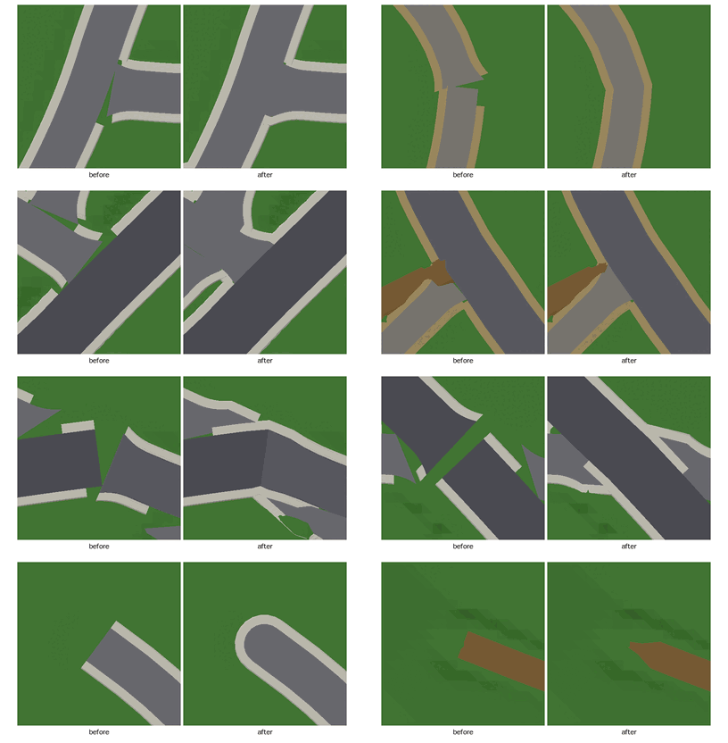
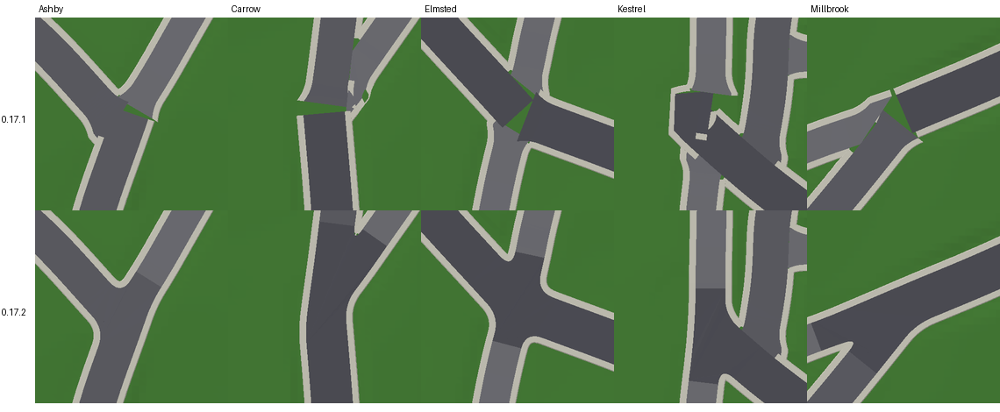
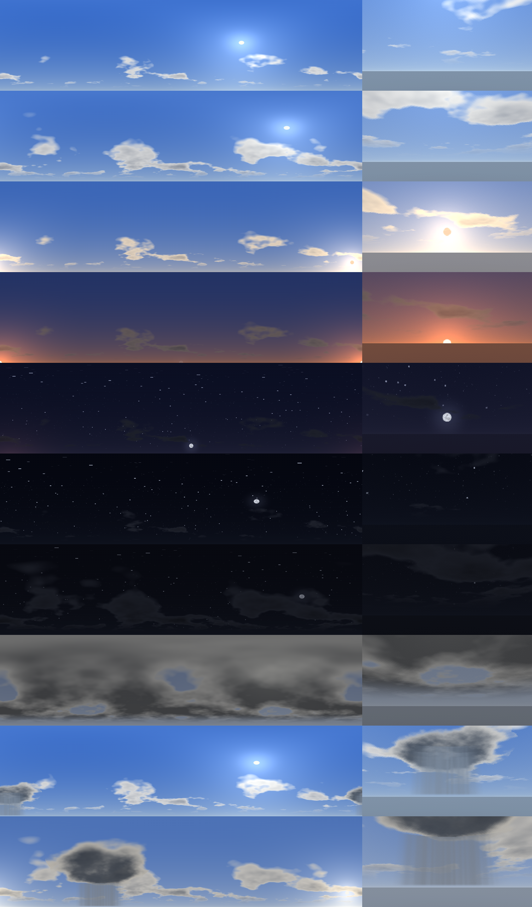
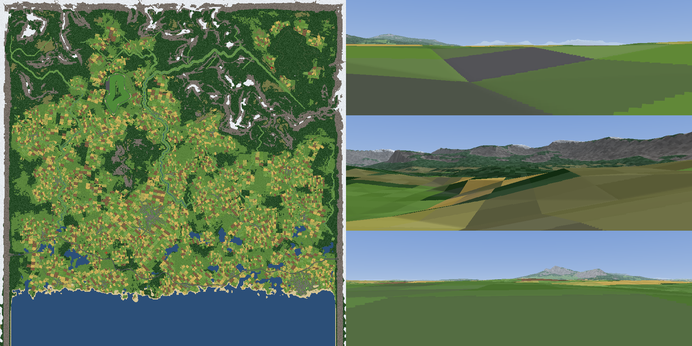

# Plan

Agreed with the owner after testing 0.4.3. Work top to bottom; each PR runs `tools/check.sh`, `tools/preview` and `tools/meshcheck`
before it goes up, and adds checks for what it fixes.

## Map API for MiniMap (0.4.6; asked for by the MiniMap mod)

Done: `MapView` (public, read by reflection; see README) gives each loaded tile's map picture (land use, water, roads by class) and
the origin. Display only, outside the plan's order; the world is unchanged.

Status: merged (PR #12), not yet tested in game. Open with the owner:
streets are drawn grey and bridges in their road's colour (world.png draws them red); change `Streamer.MapRoads` if asked. The
picture is made by `Streamer.MapPicture` from `Colours()`'s land use; no tool runs it (it needs `Streamer`), so check it in game.

## PR 1b: river water hanging over the ground (0.4.5; reported after testing 0.4.4)

On 0.4.4, 3021 of 8765 points along the rivers' water edges were over the drawn ground. Causes and fixes:

- The water level came from the land at the river's centre, smoothed; meanders put the line on slopes and smoothing lifted it
  above narrow valley floors. Now a unit under the lowest land across both banks, as cut by the rivers before it (longest first),
  never smoothed above it.
- The channel's edge was a 1.2 step; the ground's 5-unit triangles dipped under the water there. It now rises over 5, and the
  water surface is drawn far enough out to stay under the ground.
- A place's levelling sank river banks: the floodplain is now kept.
- A river's floodplain (up to 270 wide) spread across a neighbouring river or a meander's next loop, lower down. The nearest river
  now shapes the ground; others cut it through a 1 in 1 bank, and a bank up to 10 is raised beside water if needed.
- Left: 37 points (0.4%), on steep mountain bends and where a river runs right beside a lower tributary's channel.
- Roads re-routed over the new land showed a lane coming off a bridge onto a street on the floodplain: decks now ramp down over
  the banks (only the part over water is held), and mouths of streets and lanes may take up to 1.75 times their grade.

## PR 1: fixes (0.4.4: merged)

How it was done, where it differs from the notes below:

- Bridges: crossings found by intersecting road segments with river lines; each deck spans the water at the angle crossed, plus 6
  each side; `Hold` and `Seat` never move a deck; the banks beside a bridge never fill the channel. On 0.4.3, 3179 of 7351 road
  points over water were less than 4 above it (the lowest 6.1 under it); now none (`meshcheck` bridges).
- Junctions go further than the note: wherever a road's centre line runs onto a road drawn over it (bigger, or of its class and
  built earlier), at its end or in a crossing, it is cut out along that road's edges, flared, and its apron tilted to meet that
  road's surface 0.05 under it. Mouths may be up to a quarter steeper than the class grade (`meshcheck` grades).
- Farm tracks are 10 wide (were 9); the ground texture is now 128 pixels a tile (the land use stays 64) so the ruts and strip show.
  Their grip comes from a `HandlingModifier` subclass on the tile that looks the wheel's point up in the texture.
- Found on the way: a road's smoothed line could miss the router cells it was routed through, so a later route built the same
  stretch again on top of it; the cells are now marked. This changed the layout a little (fewer duplicate main roads).

1. **Bridges** (reported: a river drawn over a bridge). Likely cause: crossings are found by testing road *samples* (8 apart) for
   being inside a river's channel, so a narrow river can be stepped over with no bridge, and the road then dips below the water. A
   second suspect: `Seat` (run after `Bridges`) lowering a deck near a junction. Fix: find crossings by intersecting road segments with
   river lines; deck clear of the water over the span and its approaches; `Seat` never lowers bridge samples. Check: every road point
   over a channel at least 4 above the water.
2. **Farm tracks into the ground** (owner likes them): no mesh; the ground pressed into a shallow bed (about 0.3, soft edges); the
   ground texture paints dirt with two tyre ruts and a grass strip; no grass or trees on them; dirt grip.
3. **Dirt verges** on every paved road: a strip about 4 wide each side from the road surface down to the real ground at its outer edge,
   gravel texture, a little less grip; none on bridges. Check: no step over about 0.1 at either edge.
4. **Junctions** (rare road-on-road clipping left): a minor road ends at the major road's edge with a flat apron in the mouth;
   same-class crossings share one height. Check: `meshcheck` poke at 0.

## PR 2a: town buildings (0.5.0)

Done on branch `claude/epic-goodall-zas0pe`: compiled, preview and meshcheck clean (a new `lots` check), not yet tested in game.

- The Tokyo landmarks are gone (`Landmarks.cs` deleted); each village has a stone church with a tower and spire instead.
- **Centre:** in the main town's middle (within 0.16 of its radius) the plots take glass towers: 8 to 14 storeys, two or three
  stacked setback blocks, curtain-wall texture, plant rooms and masts on the roofs.
- **High street:** on the main roads through a town's core or a village's middle, terraces of 2 or more storeys with a shopfront in
  one of four colours (window, door, sign band) on the ground floor.
- **Lots** (`Town.cs`): a retail park at Kingsbridge's edge (car park with two double rows of bays, a lamp-post island, a big
  building with a glass front and a sign) and 34 businesses on the main roads at town and village edges: shops with a row of bays,
  workshops with a yard, filling stations with a canopy, pumps and a kiosk. A lot's surface is its own mesh with fine textures (the
  owner found the painted farm tracks too blocky, so nothing new is painted into the ground texture), level across and following
  the road's grade, its front meeting the foot of the verge; the ground under it is levelled. Tarmac grip.

## 0.6.0: teleport round key places, tracks as meshes, footpaths, sidewalks (asked for after 0.5.0)

Done on branch `claude/epic-goodall-zas0pe`: compiled, preview and meshcheck clean (new `ribbons` and `sidewalks` checks), not yet
tested in game.

- The debug teleport (F7, Shift+F7 back) goes round the key places (`Destinations.cs`) instead of a fixed distance ahead.
- Farm tracks are ribbons with a fine texture and dirt grip, no longer painted into the ground (which is back to 64 pixels a tile).
- Footpaths (`RoadKind.Path`) on from the dead ends of streets into the country.
- Sidewalks on town and village streets and main roads.

## 0.7.0: fixes after 0.6.0, parks and trails (PR 2b)

Done on branch `claude/epic-goodall-zas0pe`: compiled, preview and meshcheck clean (new `flooded`, `plants` and `parks` checks),
not yet tested in game.

Fixes the owner reported on 0.6.0:

- **Workshop walls in pinkish pinstripes.** The metal cladding had a rib every pixel (a unit) with no mipmaps, point-filtered: past a
  few car lengths it broke into moiré stripes (pinkish under the scene's grading). Ribs are now 4 pixels apart (a lit edge, the
  sheet, a shadow) with mipmaps; the roofs' rows (the workshop's metal roof is big and seen from afar) got mipmaps too. Not
  checkable outside the game: confirm in game.
- **Water over the highway.** No river did it (meshcheck's new `flooded` check found no road under a river's water): a lake's or
  the sea's surface is drawn flat over its cells and the cells round them, and the trunk road along the coast ran up to 4.3 under
  it (lanes 4.7, main roads 1.1; 11,962 of 1.2 million road surface samples). Every road is now raised to 1 over any water drawn
  over its paving, ramping at its grade (`Network.Dry`). If the owner meant a spot on a river, the check says there is none: ask
  for coordinates (`ShowCoords`).
- **Grass and trees in river beds.** The land use knows the floodplain, not the channel, so 89,686 of 606,633 plants on the
  tiles along the water stood in it; now none (`plants`).

Parks and trails (see DESIGN.md, World 9):

- **Parks**: whole blocks between streets near the towns' middles (three in Kingsbridge, two in Westhaven): striped lawn to the
  back of the sidewalk, no houses, tree clumps, a pond in the big ones with a path round it, paths in from the streets, benches.
  Kingsbridge Riverside: the river's east bank through the town, with a walk along it.
- **Walking trails**: footpaths round six of the eight lakes, tracing the shore, broken at rivers and roads, joined to the network;
  benches facing the water. Two lakes have none (their low shore runs far out); paths through parks are the parks' own.
- The debug teleport goes to the parks and lake trails too.

## PR 3: race courses (agreed after 0.7.0)

Three courses, free roam only: no race mode, no timing (a custom game mode comes later, separately). Each is placed after
`Places` and before any road is routed: its ground is a layer of the height function and its cells are closed to the router, so
roads go round it and only its access road joins it. Deterministic like the rest of the layout (`Rng`, `DetMath`, doubles).

### 3a: tarmac circuit (0.8.0)

- **Site:** the 200-unit grid scored for a box of about 4000 x 2500: flat, no river or lake in it (plus a margin), low, 1.5 km
  real or more from towns and villages, out of the mountains; the best is taken. Measure first with `tools/preview`; if no site
  fits, a shorter lap (about 2 to 2.5 km real) rather than a bridge.
- **Lap:** ProcTrack's generator ported to doubles and `DetMath` (start straight, corners, a hairpin), about 3 km real (10,000
  units), 40 wide; seeds tried in order until it fits the site. Its own `RoadKind.Circuit` (and map colour).
- **Ground:** levelled to a best-fit plane (at most 2%), banks back to the land.

Status: done on branch `claude/epic-goodall-zas0pe` (0.8.0): compiled, preview and meshcheck clean (a new `circuit` check), not
yet tested in game.

- **Lap.** A ring squashed to the box is about as long as the lap, so with dents most laps overflowed the box: each lap is now
  scaled to the target length and then down until it fits (as short as 7600 units, 2.3 km, the plan's fallback). The sine waves
  over the whole lap faded out near the corners in 200 units and folded kinks into them (most laps failed the radius checks):
  long straights other than the start straight are bent instead by an offset a sin²(πt) along each, no tighter than a 600 radius.
  A corner is slow, medium or (3 in 10) a fast sweeper of 300 to 700; right-handers down to a 130 radius (their inside is the
  outside of the loop, where only the band is). Of up to 40 laps that fit, the one with the most corners both ways is kept
  (`Character`). This world: 2.88 km, 9 corners (3 right), start straight 422 m, hairpin 18 m radius, ground tilted 0.3%, worst
  cut or fill 20 m.
- **Meshes** (`CircuitMesh.cs`): track (white edge lines, a worn racing line), kerbs rising 0.12 to their outer edge, skirts down
  under the grass, pit lane and paddock in one sheet, paint (start line, grid boxes, pit lane line); gravel traps a mesh of their
  own with low grip and high drag (0.55, 3.5).
- **Buildings** (in `Buildings.cs`): armco outside the loop (none along the pits), pit wall, a row of garages with roller doors and a
  glass floor over them, the start gantry, three grandstands (rows of seats stepping up, back wall, roof on posts). All set into the
  plane as far as it falls across them.
- **Land use** `Cover.Circuit` (mown grass, no trees, short grass) over its ground; nothing grows on its surfaces or buildings; the
  map pictures draw it. The teleport goes to the grid and the paddock.
- The circuit road is held level for its first 60 units out of the gate (its bed and banks rose through the paddock's edge).
- Found on the way: a filling station lot beside a road on an embankment sagged at its front (the ground in front of a lot is held
  0.4 over the roads' ground, which fell away down the bank); lots are no longer placed where that cap would bite.
- Not done from the list below: a paddock car park behind the pits (the paddock is open tarmac), `RoadKind.Circuit` (not needed: the
  circuit is not a road).

- **Furniture:** red and white kerbs on the corners, grass and gravel run-off outside the bends (no trees or buildings), pit lane and
  pit building on the start straight, a start/finish gantry, two or three grandstands, a paddock car park behind the pits.
- **Access:** a minor road from the paddock gate to the network; nothing else crosses the lap. Teleport to the grid and paddock.

### 3b: rally loop and hill climb (0.9.0)

- **Rally loop:** gravel, about 16 wide, through upland woods, about 5 km real: ring waypoints routed in turn by A* at the rally
  class's grade (about 12%), its own cells dear so it never crosses itself; built before lanes and tracks so they keep off it,
  joined to the network by a track. Track ribbon, bed and dirt grip; start and finish arches, a service area, tape or hay bales
  on the worst corners.
- **Hill climb:** a new narrow tarmac road (not an existing one) with switchbacks from a valley floor to a col in the northern
  mountains, about 3 to 4 km real, routed on a finer local grid (about 25) so hairpins have a real radius (about 50); start at the
  bottom joined to a lane or minor road, finish line and a turning area at the top.

Status of the rally loop: done on branch `claude/epic-goodall-zas0pe` (0.9.0): compiled, preview and meshcheck clean (a new `rally`
check), not yet tested in game. The hill climb is next (its own PR).

- **Site.** Laid out in `Places.Build` after the villages and before the farms (they keep 400 off it and out of its loop), on the
  open upland whose land's relief is nearest 30 over a disc of 2600 round it: no water, floodplain, mountains (mask 0.6), places
  or circuit. This world: the north-east plateau at (11200, 11200); half a dozen farms there moved elsewhere.
- **Loop** (`Rally.cs`): a 400-unit straight on a ring of 2300 radius, then 14 to 18 waypoints round the ring (two in five pulled in
  to 35-60% of it), routed in turn by A* on a 50-unit grid (grade cost soft 10%, steps over 24% closed, a slow noise multiplying the
  cost so it winds), each leg's cells and 150 round them closed to the legs after it. Every other cell kept, Chaikin-rounded three
  times, corners tighter than a 24 radius eased locally (only a fifth of the loops passed the radius check before that). Kept if
  13,000 to 21,000 long, never within 100 of itself past 500 along (40 for a hairpin's legs), the service area and its track's way
  out outside it; the most corners and nearest 5 km of up to 30 that pass. This world: 5.0 km, 33 corners, tightest radius 8 m,
  about 100 m climbed a lap.
- **Road:** `RoadKind.Rally` (16 wide, unpaved: a ribbon on a pressed bed, gravel texture with two worn lines, track grip; 12%),
  added first in `Network.Build`, not in the segments or the router's road cells; `Road.Loop` makes its ends meet in place. The
  router closes its cells (and the loop's inside) within 150; walks (tracks, footpaths) stop 60 off it.
- **Service area:** a lot (`LotKind.Service`, 150 by 90 gravel, four vans with awnings) beside the straight's middle, outside;
  `Town.Fit` takes an unpaved road (its surface over the stage's bed) and lets its track run behind it. The track is routed from
  beyond its back to the nearest lane and ends where its line first meets a road (`Network.RallyTrack`).
- **Furniture:** straw bales (8 by 4, 4 high, end to end) on the outside of up to ten corners under a 70 radius, 250 apart; finish
  and start arches (posts and a chequered banner) 56 in from each end of the straight. Forest land use within 400 of the stage and
  in its loop; no plants on bales or posts. Teleport to the start and the service area.
- Found on the way: a route reaches a road at the first cell the road has a sample in; a road crossing a cell's corner has none
  there, so a track built to it ran across the lane and hooked back. Fixed for the rally's track only (the other roads unchanged).

Status of the hill climb: done on branch `claude/epic-goodall-zas0pe` (0.10.0): compiled, preview and meshcheck clean (a new
`climb` check), not yet tested in game. Differs from the note above:

- **Length.** From a valley floor to a col is 100 to 150 m real in this world, so a 3 to 4 km road mostly ran along valley floors
  (the first one tried ran 2 km beside a river) and had no hairpins. The target is now about 2 km (1.4 to 3 km kept), the length of
  a British hill climb, which climbs all the way. This world: 1.53 km real, 123 m from foot to top (8% on average, 13% at most), one
  hairpin near the top, tightest radius 46 (14 m), from the valley floor at (4000, 5500) to the col by (5100, 8700).
- **Site** (`HillClimb.cs`, after the rally stage in `Places.Build`; farms keep 250 off it): cols are saddles on a 200 grid in the
  mountains (mask 0.6), the ring of land 400 round rising and falling twice by over 40. Each col gets a top straight first (200 long,
  through a point within 500 of the col and no more than 60 under it, the flattest of 16 ways if 15% or less, with room for the
  turning area beside its end: right at a col the ground rises both sides), then valley floors 1.5 to 4.5 km off, 250 or more below,
  about flat, mask 0.35 or more, each with a 260-long start straight with room for the paddock (room: the land within 7 of the
  straight's line). Pairs are routed on a 100 grid over the north and ranked by drop and length; the best six routed on the 25 grid.
- **Route.** A* states are a cell and one of 8 headings, 45 degrees a step at most, leaving the start straight and arriving at the
  top straight in line. Cost: length times (1 + 1.2 (grade / 0.10)² + 10 ((grade - 0.25) / 0.05)² past 25%), 20 a turn; no step
  over 60% or across a river line (narrow rivers ran between the 100 grid's cell centres). A hard step limit left no way up (the land
  round a col is creased at 25 units), and "never two turns running" with it; both dropped. Kept: 70 apart past 400 along, 42 past
  120, radius 40 or more after easing, cut or fill under 33 (10 m) once held to 13%; scored by hairpins (heading turning 150 degrees
  within 160) and climb.
- **Road:** `RoadKind.Climb` (8): paved, surfaced and sized like a lane, held to 13%, banks up to 60; made right after the rally
  stage, not in the segments or router, skipped by `Junctions`; its fence (120 round it, open behind its foot) is closed to the router
  and to tracks and footpaths. Its start straight and the top's last 100 (6% at most) are held to straight grades for the lots.
- **Lane:** routed from 100 behind the foot, drawn straight back from the foot and rounded into the route (the first try kinked
  127 degrees where its route doubled back), its first 30 carrying on the start straight's grade, so the two meet end to end.
- **Lots:** `LotKind.Paddock` (100 by 64 tarmac, vans and open trailers along the back) beside the start straight and
  `LotKind.Turning` (56 by 40 tarmac) beside the top, each on whichever side fits; their ground may stray 9 from the road's height.
  A lot beside an exactly straight road failed the 4-clear-of-every-road test on rounding (edge 4.0000), as the rally's did: the
  same 0.05 nudge now covers the climb.
- **Furniture:** start and finish arches as the rally's (start 236 up, finish 150 from the top). Map colour pink. Teleport to the
  start and the finish. Adds about a second to the layout.

## 0.11.0: road signs (asked for after 0.10.0)

Legible signs, with names that can be changed without touching the signs. Done on branch `claude/epic-goodall-zas0pe`: compiled,
preview and meshcheck clean (a new `signs` check), not yet tested in game.

- **Names** (`Names.cs`): every name shown (towns, villages, courses) in one list; the places, signs, teleport and labelled map read
  it. The north gate's main road is now told apart by index, not by a node named "north", so any name is safe.
- **Lettering** (`Lettering.cs`): a mixed-case pixel font made in code (caps 7, x-height 5, descenders 2; fractions ¼ ½ ¾), drawn
  a texel to a pixel into one atlas (`Signs.Atlas`, 1024 x 512 this world), point-filtered with mipmaps: material `Buildings.Board`.
- **Graph** (`Signs.cs`): junctions where a road's end lies on another road's paving or two roads cross (footpaths and the courses
  left out, their access roads in), merged within 8; Dijkstra from each town, village and course access end, costing main roads
  a little less (0.6 trunk to 1.4 lane per unit), so fingers send you along them. This world: 860 junctions, 21 destinations.
- **Fingerposts** where three ways out are main roads, or on the way to a course (from the first main-road junction its way
  reaches to its access road): 28 posts, 93 fingers. A finger per way that leads somewhere: the nearest town or village that way
  and the nearest town (within 16 miles), miles by road; brown fingers for the courses (within 10). The post in the widest angle
  between the roads, moved back until no finger reaches over a road. A first try counted a main road past a street's end as two
  main ways: 149 posts, most along town streets.
- **Name signs** on main and minor roads, streets and lanes (not the trunk road) where they cross a town's or village's radius,
  on the left of the way in, facing it, behind the verge; moved along the road (up to 64) round junctions and lots: 47 signs.
- Houses keep off signs (`Buildings.Fits`), trees too (footprints). Sizes: a village's letters 0.22 units a pixel (caps 1.5, about
  0.5 m), a town's 0.27, a finger's 0.15; boards sized to their words. Adds about 0.25 s to the layout.
- Found on the way: anything run during the layout must not call `WorldGen.Height` (it waits for the layout, and started it again
  from inside it); `Signs.Ground` gives the same height.
- `tools/preview` also writes the map named (`docs/world-labels.png`) and the atlas (`docs/signs.png`); `tools/meshcheck` takes
  check names to run only those.

### Checks

`preview` draws the courses and reports site, length, tightest corner, steepest grade. New `meshcheck` checks: lap closed and never
near itself, circuit grade and cross-fall, nothing in the circuit's fence or run-off, kerbs on the surface, hairpin radii, rally and
hill-climb grades.

## 0.12.0: a bridge's banks, country signs, through ways (reported after 0.11.0)

Merged (PR #20). Compiled, preview and meshcheck clean (`clip` now covers bridge decks).

- **Ground through a bridge's ends** at (208, -2517): a primary road in a cutting (land 57, road 53) crosses a river in a gorge.
  The deck is held at the road's height, but the ground under a deck was left alone, so the bank tops stood up to 3.3 over the deck
  at both ends. A deck now cuts the ground under it where the ground is higher (its bed and banks, as any road's), and still never
  fills: over the water and the lower banks nothing changes. The other lookups on the road index (`Nearest`, `Claims`,
  `OnOtherPaving`) still pass over decks, so nothing else moves. `meshcheck clip` skipped bridge samples, which is why it never
  showed; now it samples them too (on 0.11.0: 32 samples under the ground, worst 5.07, on several bridges; now none).
- **Fingerposts in the country**: besides junctions of main roads, every junction outside the towns and villages with three or
  more ways out by paved roads (lanes included) gets a post, as British lanes do. 28 posts became 157 (453 fingers); the lettering
  atlas is 1024 x 2048 (was 1024 x 512).
- **Through ways** (`Network.Throughs`, after the footpaths): from most dead ends of lanes, tracks and footpaths outside the towns
  and villages (85%, 55%, 75%), a way of the same class is walked on, steered towards the nearest point on another road (a point
  behind counts up to three times as far; never one within 250 of the road's own start), keeping out of towns, water, steep ground
  and the courses' fences; kept only if it reaches a road it may end on (a lane on a lane or bigger, a track on a track or bigger)
  and can climb between its two ends at its grade; a second point is tried if the first fails. Country dead ends: lanes 102 to 55,
  tracks 71 to 39, footpaths 38 to 23. Roads 150 to 166 km real (2.1 km per km²). `tools/preview` reports the country dead ends by
  class.

## Garage in the world (asked for after 0.12.0)

The owner's ask: a garage in the Open World where a player swaps items, gets ammo and gets health, without leaving the Multiplayer
room (no race end, no scene load). No currency.

### Feasibility test: done (0.12.1, `GarageTest.cs`)

On branch `claude/epic-goodall-zas0pe`, not merged. `Debug.GarageTest` (off by default) lists a key in Settings > Controls
(`Garage test (Open World)`, F9, through HalfGripTools' `ctx.Keys`; F8 is the game's bug report key; `mod.json` asks for tools
1.0.2). A press: reads the car's loadout (`PlayerLoadout.Equipped`), empties the car, fits the new loadout (the old one with the next
gun and steering wheel in the catalog), and 0.25 s later refills. Only the car changes, not the save or the Multiplayer loadout.
**The owner tested it in a Multiplayer room: every gun (the game's and the modded M1911, Minigun, RPG, Sniper Rifle, Railgun) and
every wheel swaps and works.** What it took, and what the garage must keep:

- **Fitting and removing** is the game's own live refit, `LoadoutRefit.Swap(off, on, loadout)` (the dev console's giveitem uses it
  in a race): stats re-applied, item prefabs spawned and removed, gun and shifter activators, sprites, body skin, `CarLink`. Car
  stats are read live, so engine, tires and body take effect at once. `Empty` removes items one at a time, `Fit` adds them.
- **Refill**: `Effects.Refill(RefillTarget.AllEffects, 1f)` (ammo, nitro, charges) and `Effects.Refill(RefillTarget.Health, 1f)`,
  the road pickups' path. Wait a frame or more after a refit: a new gun's rack only listens from its `Start`.
- **Guns are built into the cockpit**, one per kind (SmgAssembly, ShotgunAssembly, RevolverAssembly, SawedOffAssembly); a gun item
  only picks which is on, and taking it off only switches it off. A gun reads its item (capacity, magazines, blood-fed) and the gun
  mods convert it (M1911, Minigun, RPG, Sniper Rifle on the SMG; Railgun on the shotgun) once, as it starts up. So emptying the car
  also puts every gun back as built:
  - Copies of each gun and of its held model (`aimModel`, the 3D gun raised to the camera, under the camera, outside the gun)
    are taken the moment before the gun first wakes: Harmony prefixes at `Priority.First` on `NAutomaticGun`, `NPumpActionGun`,
    `NBreakActionGun`, `NRevolver` and `MagazineManager` `Awake` (the RPG and Sniper prefixes replace the SMG's Awake, and three
    of the four guns wake before `GunLoadoutActivator`). Kept under an inactive object moved into the race scene.
  - On reset, the live gun and held model are detached, unregistered from `Rig` and destroyed, and fresh copies put in their place.
  - The gun's references into its held model (fire point, the sawed-off's `barrels` array) are remapped by path, arrays and lists
    included, both when the copy is taken and on each reset.
  - The copies' sprites are recorded when taken and put back on each fresh copy: the gun mods' `Sprites.Reskin` swaps sprites by
    name across the whole scene, inactive objects included, and had put the Sniper Rifle's art on the stored SMG copy.
- **Multiplayer**: nothing new goes over the network. Others see only paint and body (`Skins` re-sends the body each second), PvP
  damage is applied on the owner's car, and HP goes as a fraction in each `Car` packet. Items stay local.

Looked into after the test (0.12.2), the two gaps the notes above named:

- **The Minigun's roof gun stayed on the car after swapping away.** The roof gun is built on the car body by `MiniHeat.Setup` and
  taken down only by `MiniHeat.Cleanup`, which the Minigun mod calls only when it unloads; `MiniHeat.OnDestroy` does not. Putting the
  SMG back as built destroys `MiniHeat` with the gun, so the roof gun was left turning on the roof (pointing ahead, its gun gone).
  Emptying now takes every Minigun roof gun off the car and runs each `MiniHeat.Cleanup` (by name: the classes are internal) before
  the guns are put back; a Minigun fitted again builds a fresh one as its gun starts. Only when an SMG copy exists (otherwise the SMG
  is not put back and the Minigun stays whole). The **remote** cannot stay: the reading of the code and the Tokyo scene dump puts
  everything the Minigun changes in the cockpit (the remote's sprites and its holder moved by `RemotePlacer`, the heat bar on the rack,
  the overheat padlock, the held model's mesh) under `SmgAssembly` or `HeldSmg`, which are replaced; to be confirmed in game (README
  test 22). The other gun mods: the Sniper Rifle's laser dot and scope overlay go in its gun's `OnDestroy`; the Railgun's charge and
  the RPG's launcher are components on the gun object; the RPG's rockets in flight, explosions and scorch marks are meant to outlive it.
- **Rockets from an RPG fitted mid-race.** The note was wrong as to the cause: the Multiplayer mod (`Cues.FindRocket`) looks up the
  RPG's rocket *type* by name once per game session, not the fitted gun at race start, and 20 times a second sends every live
  `RpgProjectile`; its Harmony prefix on `Explode` is on the type too. Its aim cue re-reads the guns every second. So an RPG fitted by
  the refit should show to the others exactly as one fitted at the start; the README's test 22 now asks for that in a room. (Others
  see the RPG's aim as an SMG's either way: the cue sends the gun's `RequiredGunType`.)

### The garage: agreed with the owner (after 0.12.1)

The owner's answers to the open points:

1. **Where, and on the map.** Small circular waypoints on relevant existing buildings: the filling stations (`LotKind.Garage`, 5 in
   this world) and workshops (`LotKind.Workshop`, 10), the circuit's pit garages (`Circuit.GaragesA/B`), the rally service area
   (`LotKind.Service`) and the hill climb's paddock (`LotKind.Paddock`): 18 in all. Generation does not change:
   they are read from the layout. Each is a mark on the map, not a moving waypoint, that MiniMap shows **without any change to MiniMap
   or to `MapView`'s members**: MiniMap draws `MapView.TryGetTile`'s pictures, so the mark is painted into the tile's map picture in
   `Streamer.MapPicture` (after the roads, so it sits on top), a filled disc in a colour nothing else uses, with a dark ring, at least
   3 pixels across (a tile is 64 pixels for 250 units) so it survives the minimap shrinking it. README's map colour list and `MapView`'s
   summary gain the mark; `tools/preview` draws it on `world.png`.
2. **Opening.** In the waypoint's circle, the car stopped (nearly: under about 1 unit/s) and the gearbox in **neutral** (the active
   shifter's `gear == 0` or not `inGear`, read through `CarLink`, which covers every shifter kind) opens the garage. No key. Open, the
   player is in **god mode**: `CarLink.godMode` (the game's own, which `TakeCrashDamage` checks: crashes, hazards and the Multiplayer
   mod's PvP hits all come through it) plus HP held at what it was on opening (regeneration and drains are put back each frame), until
   the garage closes (a Close button, or the car put in gear and moved off). Only the garage's Repair raises it, to full. `godMode`
   is set back only if the garage set it (the Multiplayer mod sets it for a player who has finished). Opening also fills nothing by
   itself: Repair and Refill are buttons.
3. **Items.** Every item available by normal means: the catalog's items that are not `disabled` (the game's own flag for items kept
   out of play: the shop, unlocks and rewards all skip them), locked or not, the gun mods' items included, by unique id. Not the
   consumables (`UpgradeCategory.CONSUMABLE`: used up from the inventory, no slot to fit them in). In a Multiplayer room, also not
   what the Multiplayer mod leaves out of its own garage (`Loadout.Banned`, read by reflection so its list stays the one rule: slow
   motion, rerolls, run boons, beer, time rewinding), which break a shared race; solo, those are offered.
4. **Not remembered.** Nothing is written: not the save (`equipped`/`inventory`), not the Multiplayer mod's loadout. The garage only
   changes the car, as the test does; the next race starts with the loadout picked in the menu.

The overlay (the garage scene's drag-and-drop UI exists only in that scene): slots by `UpgradeCategory` as `DevCommands.Slots` names
them (two medium slots), each item card with `item.image` and `item.Name`, fit and remove, Repair, Refill, Close; the cursor freed
(the `Grabber` locks it) and driving input held while open. Changes apply on Close or on each pick (to decide in the first build:
each refit empties and refits the whole car, under a frame). Gun copies are taken in every Open World race, not only with
`Debug.GarageTest`; `GarageTest` and its key go when the garage replaces it.

### The garage: built (0.13.0)

On branch `claude/epic-goodall-zas0pe`: compiled, preview and meshcheck clean (a new `garages` check), not yet tested in game.

- **Sites** (`GarageSites.cs`, no Unity, read from the layout): 20 in this world, 5 filling stations (34 back on the forecourt,
  between the canopy's posts and the kiosk), 10 workshops (13 back, mid-yard), 3 in the circuit's pit lane in front of the garages
  (radius 8), the rally service area and the hill climb paddock (three tenths of the way back, clear of the vans); radius 9.
  `meshcheck garages`: every circle's edge and middle on its own lot's surface or the pit lane, off buildings, pumps, posts, vans and
  awnings, at the surface's height, its ring over the ground, none overlapping.
- **Map**: `Streamer.MapGarages` paints a cyan disc (2.5 pixels) in a dark ring (1 more) over everything in each tile's map picture,
  so MiniMap shows it as it is; `tools/preview` draws the same on `world.png` and lists the sites.
- **In the world** (`Garage.cs`): a cyan emissive ring on the surface (following its slope, 0.14 over it) with four dashes pointing
  in, under the world's root so the origin shift moves it; `GARAGE` over each circle within 220 units.
- **Opening**: in a circle (and within 6 of its height, not on a bridge), under 1.2 units/s, the active shifter in neutral, when the hand
  lets go of it (`ShifterHand`; until 0.17.0 it was neutral for 0.6 s).
  Then `CarLink.godMode` (set back only if the garage set it) and the health held each `LateUpdate` (capped at the new maximum after a
  refit); input muted (`GameInput.Mute`), the cursor freed and the hand hidden, as the Multiplayer mod's pause does. Closed by Close or
  Esc (the controls back the frame after, so the Esc does not open the pause menu), or if the car is pushed out or knocked moving. It
  does not open again until the car leaves the circle, moves or goes into gear.
- **Window** (`GarageUi.cs`, IMGUI scaled to the screen's height, the game's m6x11 font if found): slots down the left in category
  order under Car (chassis, tires, engine, shifter), Cockpit (steering wheel, gun, two medium slots) and Extras (passive, exterior);
  the chosen slot's items on the right, best tier first then by name, in tier colours, "not unlocked yet" on locked ones, the fitted
  one marked; the hovered item's picture, name and the game's own description (its stat lines; TextMeshPro tags removed) underneath;
  Leave empty; health bar with Repair; Refill ammo and nitro; Close. An item fits as it is clicked (the whole car is emptied and
  refitted, `GarageRefit.Apply`), ammo and nitro filled 0.25 s later. A medium item picked for one slot leaves the other. Items on the
  car no slot takes are carried through untouched. Mouse only: no gamepad navigation.
- **Items**: `Garage.Offered`: not `disabled`, not consumable, unique id; in a room not `Multiplayer.Loadout.Banned` (by reflection;
  the same four types if it cannot be found).
- **Not remembered**: the first refit keeps `PlayerLoadout.Equipped`; when the world goes (`Garage.OnDestroy`), or before the next
  car is fitted (a prefix on `LoadoutSpawner.Awake`), the stats and `PlayerLoadout` are put back, unless the game set or dropped the
  loadout itself in between (postfixes on `PlayerLoadout.Set`/`Forget`): in a room the next race starts without the menu and is
  fitted from `PlayerLoadout`.
- **Refit** (`GarageRefit.cs`, was `GarageTest.cs`): the guns are copied in every Open World race; the debug key and `Debug.GarageTest`
  are gone. `tools/meshcheck` no longer compiles the garage's game-side files (the test had broken its build).

### The garage: first test and changes (0.13.1)

The owner tested 0.13.0 alone (no second player, so nothing yet on what other players see): the circles on the ground look right and
the Minigun's roof gun comes off. Asked for, and done on the same branch:

- **Map marks as wide as a road**, hiding what is under them: the disc is 5.5 pixels round and the ring 1 more, 13 pixels (about 50
  units, between a primary road and a trunk road) across. Garages within 160 units of each other (`GarageSites.MarkGroup`, joined
  along chains, in the sites' order) share one mark at their middle (`GarageSites.Marks`): 16 marks for the 20 garages (the three pits,
  and two places where a filling station and a workshop face each other). `meshcheck garages` checks every garage is in a mark and no
  two marks run into each other; `tools/preview` draws the marks and lists the groups.
- **Drag and drop**: an item dragged from the list onto a slot it fits (lit while dragging) is fitted; a fitted item dragged off its
  slot (anywhere but another slot) comes off; dragged onto the other medium slot, the two swap. Dropped on a slot it does not fit, it
  says so. A left click on a slot chooses it; on a list item, keeps its description shown.
- **Right click** on a list item fits it (into the chosen slot, or the empty medium slot if the chosen one is full) or takes it off if
  it is fitted; on a slot, takes its item off.
- **Pixel look**: panels, slots, cards, icon wells and buttons are nine-sliced pixel-art boxes (3-unit pixels, a near-black outline
  with cut corners, a light top-left edge and a dark bottom-right one; sunk for wells and a pressed button), the game's dark greys
  and its orange for the chosen slot and a pointed-at button, cyan for what is fitted; headings and names with a hard drop shadow;
  health as a row of blocks, green, red under 30%.

### The garage: second test (0.13.2)

The owner's second test (screenshots): the window works. Asked for, and done:

- **Map marks doubled**: 11 pixels round and a 2 pixel ring, 26 pixels (about 100 units) across; garages within 250 units share one
  (15 marks for 20 garages); meshcheck's marks are at least 110 apart.
- **The prompt raised** to 56% of the screen's height, clear of the steering wheel and the shifter.
- **The health row no longer overlaps the slots**: the window is 800 high (the ten slots and three headings take 568).
- **Less cyberpunk, more grungy**: no cyan in the window or the prompt (only the world's `GARAGE` labels, which match the rings);
  oily warm greys, the HUD's orange for the chosen slot and a pointed-at button, a dirty mustard for what is fitted and drop targets,
  cream lettering, an olive health bar (rust red when low), and a tiled grime texture (specks, blotches, the odd scratch, an integer
  hash) over every box and button.

### The garage: the vanilla garage's colours (0.13.3)

The owner found 0.13.2's orange and brown gross and sent a screenshot of the vanilla garage to take the colours and theme from (not
its layout). The window and prompt now use them: a dark slate frame, worn mid-grey metal tiles with a near-black outline, black
wells for the pictures and the health bar, white lettering; the vanilla red (its map button, its prices) for the chosen slot, a
pointed-at button and the headings; its unlock bar's green for what is fitted, the drop targets and the health blocks (red when
low). The grime stays, neutral grey instead of warm.

### The garage: readable text (0.13.4)

The owner's screenshot of 0.13.3: the grey slot names and tier names could not be read on the grey metal. Now the tiles are a
darker metal, every line on a slot or card is light (or the item's tier colour) with the hard black shadow, and the title is
`GARAGE` in red and the garage's name in white.

### The garage: room for the text (0.13.5)

From the owner's screenshot of 0.13.4: the instructions were still grey, and the slots and cards a little small for their two lines.
The instructions and the leaving hint are now light; the slots are 56 high (59 apart), the cards 64, their pictures and text moved
to match, and the window 860 high to hold the taller slots.

### The garage: no grey text left (0.13.6)

The game's descriptions grey their flavour line (for its own light card): every grey or dark colour in them is now lifted to the
window's light text, the stat lines' colours kept. The other secondary text and the full-health button's label (no longer dimmed;
it does nothing when health is full) are the same light grey-white.

### README trimmed (with 0.13.6)

The owner found the README bloated. It is now for players and other mods' authors: a short feature list, install, playing, the
garages, settings, names, the map API and checking a change. The long "How it works" moved to `docs/DESIGN.md` ("How the code
works"), and the in-game test checklist to `docs/TESTING.md` (CLAUDE.md points there).

## Game mode: respawn at the start, no AI (0.14.0; asked for after 0.13.6)

The first part of the Open World's own game mode (`GameMode.cs`). The owner chose to keep it in the Open World rather than add a mode
to the Multiplayer mod's picker (its modes are fixed in its own code, with no way for another mod to add one). What it does:

- **Forced respawn.** Solo, the game's end-of-race on a wreck (`TrackManager.OnPlayerDestroyed`) is skipped in the Open World;
  `GameMode` sees the health reach 0, shows `WRECKED`, and after `RespawnSeconds` (3, a local setting) fills the health and resets
  the car. The wait is game time, so it holds while paused; a charm or heal that saves the car first cancels it. In a Multiplayer room
  the Multiplayer mod already skips that end-of-race and respawns or spectates by the room's race settings: as the world loads, every
  player sets their copy (`Room.Race`) to respawn, and a Demolition to a race (`MultiplayerLink.RoomRules`, by reflection like the
  rest). The room's respawn time counts.
- **At the spawn.** The reset after a wreck (either way it goes through `PlayerResetLogic.ResetOnTrack`, patched by `ResetInPlace`)
  puts the car at the spawn facing up the road, on the first of 24 grid slots (`WorldScene.GridSlot`: the spawn, then pairs behind it,
  18 apart) with no other car within 8. A plain reset (hold R) stays in place.
- **No AI.** Solo there were none already (`NoRivals`). In a room `RoomRules` also sets the race's AI count to 0 and empties
  `Room.AiGrid` (the slots the host dealt the AI cars) before the scene's start, when the Multiplayer mod spawns them.

The owner tested it with 0.17.0: good (TESTING.md 17b).

### 20 players: investigated, held off

The cap is the Multiplayer mod's, not the Open World's:

- `Room.MaxPlayers` is a `const` 6. The Steam lobby is created with that limit, a 7th player is turned away, and the lobby screen's
  member and result rows are arrays of that size. A `const` is compiled into every place it is used, so no other mod can raise it:
  only a change to the Multiplayer mod can (its owner's repo).
- Its grid: the host deals slots from `Enumerable.Range(0, 6)`, and a race scene gets 6 slots (the player's and 5 more, extra ones
  added behind the last if the scene has fewer). The AI slider is also `6 - players`. All of that would need to grow with the cap.
- The Open World is ready for more: `WorldScene.GridSlot` gives any number of slots along the spawn's road (20 cars is 10 rows, about
  55 m), and the respawn already uses 24. The scene's own start-position objects (that the Multiplayer mod reads) number what Tokyo
  has; the Open World would add more if the Multiplayer mod asked for more than 6.
- Traffic: every player sends its car to every other player 20 times a second (about 70 bytes a packet), so with 20 players each
  sends and receives about 19 x 20 x 70 = 27 KB/s, which Steam's relay handles. Unknown until tried: 19 stand-in cars with full
  physics on each machine, and the host's share of reliable messages.

So 20 players needs, in the Multiplayer mod: `MaxPlayers` raised (or made a host setting), the lobby screen's lists made to scroll, and
the grid slots and their dealing sized from it. Worth asking its owner for, along with the mod channel below.

## Solo events (0.15.0; asked for after 0.14.0)

Step 2 of the events plan below, begun. What is in:

- **Courses as data** (`Courses.cs`): the circuit (3 laps from pole), the rally stage (start line once round to the finish line) and
  the hill climb (start line to the finish below the col), each a centre line with the drawn surface's heights (the circuit's track,
  the other two their road's, `Network.Top` included), a start box (the circuit's pole slot; 20 behind the start line on the other
  two, its radius cut to fit a narrow road) and checkpoint gates spaced evenly, about 1000 units (300 m) apart, the last of each lap
  on its line. Read from the layout, so the same for everyone and nothing changes in generation. A best time's key holds the course,
  its length and laps, so a course a new version lays out differently starts afresh.
- **The event** (`EventRace.cs`): stop in a start box in neutral and let go of the shifter (as a garage) and a countdown runs (the name, 3, 2, 1);
  leaving the box or rolling before GO is a jump start. Then the clock (game time: it stops on pause) runs; a gate counts when the car
  crosses its line going forwards within its reach (the road's half width, the circuit's kerbs, and 10 more). The next three gates
  past the expected one are watched too: crossing one of them calls out the gates missed and goes on from it; a run with any missed
  sets no best. The next two gates are drawn (orange posts and a bar, no collider; the finish white), placed only when the next gate
  changes. A wreck resets to just past the last gate (`GameMode.ToSpawn` asks `EventRace.Respawn` first). More than 500 units off the
  centre line for 10 s, or a jump of more than 150 in a frame not made by the respawn (a teleport), gives the event up. The best time
  of each course goes in the mod's config file under `[Best times]`.
- **Checked** in meshcheck (`events`): gates in order to the finish, at the drawn surface's height, each reaching over its own stretch
  only (a hairpin's other leg is never in a gate's reach), no gate's respawn point on a bridge (the reset puts the car on the ground);
  each start box whole on the road, its ring just over the drawn surface, clear of the garages. The preview lists the courses.

Not yet: a ghost of the best run, split times against the best at each gate, AI rivals, and the room's events (step 3).

### Solo events: off the course, the start lights, the cockpit's board (0.15.1)

From the owner's first try of 0.15.0: the timer (a panel drawn over the screen) looked basic, the start box should be off the track
with the car then put on the grid, and the countdown and green light were not seen.

- **The countdown.** The game's text queue takes a line only while it holds one or none, and types each out a letter at a time:
  the course's name was still showing when 3 came, so 2 and 1 were dropped and the rest came late. Each call-out now clears the
  queue first. And the game's own start lights (`RaceStarter`, which WorldScene hangs over the road at the spawn) are moved over
  the course's start line as the car is put on the grid, turned about the vertical so the green sprite faces up the course: red,
  amber, both, green, a second apart.
- **Off the course.** The start box is in the circuit's pit lane between the last garage's circle and the end of the lane's full
  width, and in the rally service area and the hill climb paddock at 0.3 of the lot's width to the side of the garage's circle nearer
  the grid. Stopping in it in neutral puts the car on the grid spot (the circuit's pole slot, 20 behind the start line elsewhere);
  creeping more than 4 off it or rolling at 3.6 before green is a jump start. A wreck before the first gate goes back to the grid.
- **The cockpit's board** (`EventBoard.cs`): the game's leaderboard (`StatusInfo`) and lap counter at the top right. In an event the
  leaderboard's updates are switched off and its text is the event's (course, clock, checkpoints or the last lap, best in the game's
  purple; the result after the finish), and the lap counter shows the lap or the checkpoint; the clock is green while the lights are.
  Out of one the board slides into the right edge, a sliver left on the screen (its outline measured on the screen each frame through
  the hand's camera, and moved along the camera's right); the hand over the sliver (not while holding something) slides it out with
  the game's leaderboard, the cars in the race. The lap counter, which counted the token loop's meaningless laps, now always shows
  what the board sets (the count of cars out of an event).
- meshcheck's `events` now checks the grid spot on the road and the box off the course, whole on its lot's open surface (clear of
  the vans and awnings) or the pit lane.

From the owner's notes on 0.15.1:

### Solo events: the start box's panel, held on the grid, the map's flags (0.15.2)

- **The panel.** In a start box the event is offered in a panel like the garage's (`GarageUi.EventPrompt`, text from
  `EventRace.Prompt`): the course, length, laps, checkpoints, best, and what to do. The cockpit's board no longer shows the offer:
  it stays tucked away until the car is on the grid. "EVENT" (orange) floats over each box as "GARAGE" over each circle.
- **No jump start.** The car is held on the grid from the moment it is put there until green: its rigidbody's x and z and its turn
  about the vertical are frozen (`EventRace.Hold`; that broke the car's physics, see 0.15.3), so the suspension settles it and the
  wheels turn, and it goes on the green.
  The game holds its own grid by leaving the car's controller off, but that controller is the suspension. A move of more than 30
  from the spot (a reset after a wreck goes to the spawn) or a wreck gives the event up and lets the car go.
- **The map.** Each start box has a mark on the map pictures (`Courses.MapMark`, drawn by `Streamer.MapEvents` over the garages'
  marks and by the preview).

### 0.15.3: the grid hold made the car NaN; a chequered disc on the map

From the owner's try of 0.15.2 (log): just after `Event: signed on at the Circuit, on the grid` every frame logged an origin shift
`by (NaN, NaN)`, and the world was lost.

- **The cause.** 0.15.2 held the car on the grid by freezing its rigidbody's x, z and yaw. A frozen rotation axis zeroes the body's
  inertia about it, and the game's tyre code (`CarControllerNew`, the grip impulse) divides by `rb.inertiaTensor.y`: the forces went
  NaN and so did the car's position. `Origin.Follow` then shifted the scene by NaN each frame (a NaN fails every `< limit` test).
- **The hold now** (`EventRace.Hold` and `FixedUpdate`): no constraints. The spot is kept in world coordinates; each physics step
  while held the car is put back on it (turned into the scene's coordinates then, so an origin shift on the grid cannot move it) and
  loses its velocity across the ground and its yaw rate, keeping its height, pitch and roll, so the suspension and the wheels work.
- **A guard.** `Origin.Follow` never shifts by a NaN or infinite car position (one warning in the log instead), so a car whose
  physics breaks can no longer take the world with it.
- **The map's mark** is a chequered disc, laid out like the garages' discs (the flag reached out of its tile and over the road
  above it): squares of 5 pixels in a disc 26 across, an orange ring and a thin dark one, 33 pixels across in all, centred on the box.

The owner tested it with 0.17.0: good (TESTING.md 23, with the shifter let go in neutral).

## Respawn at a garage (0.16.0; asked for after 0.15.3)

The last addition before the branch is merged into main. A garage's window has a third button along the bottom, **Respawn here**:
a wreck then comes back to that garage instead of the spawn, for the rest of the race.

- **Not saved.** The choice is a field of `GameMode`, which is made with the world and goes with the scene: every race (solo, or the
  room's next race) starts with the spawn again. Nothing goes in the config file or the game's save.
- **Where.** `GameMode.ToSpawn` puts the car at the circle's middle, facing out (`GarageSites.Site.Hx`, `Hz`: towards the lot's road,
  or along the pit lane to its exit), and keeps the garage shut until the car goes into gear (`Garage.Disarm`), as after closing
  it. If another car is within 8 of the middle (another player respawned or parked there) it goes to the spawn's grid slots instead.
  An event's wreck still goes back to its last gate first. The call-out says where: `BACK AT THE GARAGE`, `BACK AT THE START` or
  `BACK AT THE LAST CHECKPOINT`.
- **The window.** Pressed again on the same garage it reads **Respawn at start** and clears the choice. The bottom right says where a
  wreck goes (the start, this garage, another garage) when no other message shows; the old "To leave" hint made way (the prompt
  after closing says to shift into gear).
- meshcheck's `garages` now checks each respawn spot: the heading a unit vector pointing out, the car's 14 by 6 footprint in the
  circle and the ground `Streamer.Place` drops it on within 0.5 of the garage's surface.

Not tested in game yet (TESTING.md 22b).

## Day and night, and storms (0.17.0; asked for after 0.16.0)

Free roam in a room had one weather for the whole race, with rain or snow everywhere at once. Now the time of day goes round and
the weather moves across the country. Everything comes from the room's seed and the race clock (`TrackManager.TimeSinceRaceStart`,
started on the host's go), so every player has the same sky and nothing is sent. Nothing about it is a setting for that reason
(the Open World is always played from a room); only the debug skip is.

- **Storms (`Storms.cs`).** Rain cells: each 10 minutes of race gives birth to up to 20 (fewer on a drier day, the day's raininess
  from the seed), 1400 to 4400 across, living 20 to 60 minutes, building up and dying away, drifting with the wind (from the
  seed, swinging slowly over the race) at 4 to 11 a second, so a car outruns one easily. Rain is hardest in a cell's middle with a
  ragged edge; its cloud reaches 1.8 times as far, so the sky darkens first. High ground gets a little more. Above the snow line
  (330 to 480 from sea level, from the seed) it snows, with sleet either side. Wetness looks back 10 minutes, so a road a storm has
  passed stays wet and dries. Pure arithmetic under the world's determinism rules. `tools/stormview` checks it: over 20 seeds the
  rain covers 1 to 3 % of the land on a dry day and about 20 % on a wet one (10 % on average), a seed always gives the same weather,
  and a sample costs about 8 µs (a wetness, every second, 0.2 ms).
- **Day and night (`Sky.cs`).** A day lasts 40 minutes (100 seconds an hour); three races in four start between 07:00 and 17:00,
  the rest at any hour. The sun goes from east to south to west, at most 55° up; the light is never put below 7° (long shadows
  flicker) and fades out round the horizon while the moon takes over opposite. The light turns gold low down. `Weather` now draws a
  day look (the weathers with a sky and no headlights: Stadium ash, fiery factory, Forest rainy day, red forest, mountain day; the ash taken out in 0.24.0) and a
  night look (the night weathers with a sky); the light's and fog's colours and the sky blend from one to the other, the day sky
  dimmed and tinted at dusk, the night sky (its stars turning) swapped in once it is dark. The night weathers' moonlight is made
  for racing in an arena, so it is taken at 35 %. Headlights go on from dusk to dawn and under a black sky.
- **The game's weather taken over.** The game applies a weather once, as the scene starts. `Sky` keeps its own copy of the day
  look as `WeatherController.activeProfile` (so the game moves our rain with the car) and as `WeatherGrip.Current` (so the grip
  read is ours), and sets the light, the cabin light (`SyncInteriorLight.maxIntensity`, which ignores the weather), fog, sky
  exposure and tint and reflections every frame. The Tokyo scene pins its ambient light (`AmbientProbeKeeper`), so its stored probe
  is scaled per colour (blue at night, darker under cloud) and handed back through `Store`. Rain and snow are the scene's own
  particles at a rate set by the rain at the car (the game's weather budget cut applied, since setting the rate takes them out of
  `RenderBudget`), dimmed at night; the rain's sound is ours, as loud as it rains.
- **Rain landing on the ground.** The game's rain and snow collide with a plane (`Weather/ParticleColliderPlane`, Tokyo's ground
  level), a collision plane, so switching its collider off (which `WorldScene` did) changed nothing: the drops stopped and splashed
  at the spawn's height, in mid-air over low ground. First fix (tested, failed): collide with the world's colliders at medium
  quality. Unity caches the colliders as static at that quality, and every origin shift moves them (and the streamer swaps them),
  so after the first teleport the drops hit ground that was no longer there and the rain vanished; a ray per drop (high quality)
  costs too much for 10000 drops. Now the plane stays and `Sky.MovePlanes` puts it, ten times a second, under the rain, tilted to
  the ground: a plane fitted (least squares) to the ground or water on a 7 by 7 grid over a 120-wide square round the rain, then
  lowered until it is nowhere above that ground, so no drop stops in the air. A level plane at the lowest ground (tried first) sat
  far under the road on any hill, so going up or down one no drop landed near the car. Measured over 3000 spots on the land, at the
  car (50 behind the rain's middle) the plane is under the ground by 2.4 typically, 6.5 at the 90th percentile and 25 at the 99th
  (level at the lowest: 6.2, 23, 69). Each ground sample costs about 3 µs. Each drop dies where it hits (its splash is a collision sub-emitter) and lives twice as long (2 s was made for
  Tokyo's flat ground). The log says `Sky: rain and snow land on 1 collision plane(s)`; with `VerboseLog` each system's setup.
- **Wet roads.** The road, sidewalk and circuit materials darken and shine as the ground at the car is wet; tracks, verges, gravel
  and the ground darken. Grip: up to `x0.96 ^1.06` wet (the game's own rain is `x0.97 ^1.05`), a little less on snow. The look is
  the wetness at the car, for every road in view: a road a kilometre off is as wet as the one under the car.
- **Debug.** `ShowCoords` adds a line: the time, the sun or moon's height, the rain or snow, cloud, wetness and grip at the car,
  the nearest storm (how far, which way). `WeatherSkip` with its key (F5 in Settings > Controls, through `ctx.Keys`, like the teleport's F7) moves your own sky 5 minutes on (Shift back); the Weather fast key (F2) toggles it running 10x.

**Garages and start boxes on letting go of the shifter** (0.17.0, asked for): they act when the hand lets go of the active shifter in
neutral (`ShifterHand`: the grabber's held object under the active shifter's object), stopped and armed as before, in place of
standing in neutral for 0.6 s. Arming, the prompts and `Garage.Disarm` after a respawn are unchanged.

The owner tested 0.17.0 in game: good (TESTING.md 21, and 22 and 23 with the shifter let go in neutral). Next: rain curtains and dark cloud under the storms nearby (seen from
afar; done in 0.19.0), a sky of our own painted in code (sun and moon discs, stars, a gradient; done in 0.18.0), wetness per tile, lightning in the hardest
storms, lights on the Multiplayer mod's stand-ins (other players' cars have none, so they are hard to see at night), glowing
windows and street lamps.

## Junctions and dead ends (0.17.1; asked for after 0.17.0)

The owner reported many junctions messy, not meeting or clipping through each other, and dead ends ending hard. Repairs only: no
road is moved, added or taken out. Measured with a scratch tool that draws every junction's meshes from above (the new `holes`
check is its core): of the roads' paving round the 746 junctions, 3.78% had no paved surface on top on 0.17.0 (ground, a verge or a
sidewalk showing through), now 0.84%. Before and after, the same junctions from above (`docs/junctions.png`).

What was wrong, and the fixes (`Network.cs`, `RoadMesh.cs`):

- **Wedges of ground in mouths met at a slant.** Each edge of a road ending on another was cut where *any* line from that edge to
  the centre ran onto the other's paving, and never later than the centre line: the edge reaching the other road last stopped short
  of it by up to the road's width. Now each edge is cut where it itself runs onto the other's paving, the slant between them
  following the other's edge; whatever runs on past lies under the other's surface. An edge that never reaches the other (it passes
  its square end) is cut on the line through the other edge's cut and the centre line's.
- **Verges and sidewalks missing beside mouths.** A road's verge stopped with its full-width surface, not at its edge's own cut;
  the road met's verge or sidewalk was left out a whole piece (8) at a time. Both now run to the mouth's edge (to half a unit).
- **Roads meeting end to end** (about 120 places: a lane on from one farm to the next, a street on from a main road's end) were cut
  as junctions: a notch, ground each side, a main road's square end standing out across the streets in a village. They are now
  drawn as one road round the bend (`Network.Joints`): both take the side across the bend at the joint, one height, the narrower
  widening to the other over 24. With more roads ending there, the biggest carries on into the straightest and the rest meet the
  two as at a junction. Not where the bend is over 75 degrees, a road hooks round near its end (the hill climb's lane does, at its
  foot), or a road passes through.
- **A short street with both ends on other roads** was cut out whole (one cut from its first point on another road to its last).
  Each stretch is cut on its own, the rest brought under the road it runs alongside.
- **Cuts against a road not drawn there**: a third road was cut along a main road's stretch already cut away, leaving holes
  (Redford). Only drawn paving cuts now.
- **Steps at the seam**: only the sample inside a cut met the other road's surface, so along a long slant the mouth fell up to a
  unit under it. The samples either side meet it now (held by the regrade), and where the cross-fall is held to 8% the higher side
  goes under instead of halfway.
- **Tracks over a lane's mouth**: a mouth brought down to the road it meets left a track meeting it there above it, drawn on top.
  Tracks and paths are kept 0.04 under any paved surface they run onto (`Network.Tuck`), eased in at their grade.
- **Dead ends** (178 paved, 68 tracks and paths, from `Network.DeadEnds`): a paved road is rounded off in a half disc with its
  verge or sidewalk carried round down to the ground; a track's or path's ribbon narrows to a fifth over its last 16.
- meshcheck: new `holes`, `joints`, `deadends` and `tucked` checks; `poke` and `tucked` read the other road's surface with its
  cross-fall and only beside the piece the point is on (a point past a piece's end took that end's height).

Left: where a road ends in the corner between two others (a cut is one straight slant, so a little ground can show in the corner),
and the few places where several main roads end at one point (Redford's middle) are better, not clean. Knock-on: plots at
junction corners see the mouths and joints now drawn, so a few houses moved or went (483 to 475 buildings round Kingsbridge);
everything else the same. A town tile builds in 23.9 ms (21.6). Compiled; meshcheck and preview clean; not yet tested in game
(TESTING.md 24).

### Villages where three or more roads end (0.17.2; the owner's report on 0.17.1)

The owner found junctions still broken at Ashby, Carrow, Elmsted, Kestrel and Millbrook (teleport stops). All five are a village's
middle, where every main road through it starts or ends at one point (the Gabriel graph's links all end at the village), and often
a street or a fourth road ends a few units off it. `Joints` drew the biggest pair as one road and cut the rest against them: their
square ends stood out across each other and a wedge of ground showed in the middle. Where another road's paving covered the point,
nothing was joined at all and every end was cut as at a T.

Now such a place is a **hub** (`Network.Hub`, `TryHub`/`MakeHub`; drawn by `RoadMesh.Plate`): at least three paved roads ending
within half a unit, plus any road whose paving is on the point (ending within 24 of it: an arm from its end; passing through: two
arms, at most one such road). Arms round the place in order; for each pair of neighbours, where the left edge of one meets the right
edge of the next (out ahead, or back past the place for arms more than half round apart; none for arms about opposite). Each arm is
cut where the curve between it and its neighbours starts, 12 out along its edge from that meeting point; the plate's outline runs
cut, down the arm's edge, round the curve (a quadratic from the meeting point), up the next arm's edge; cut into triangles (ear
clipping, no slivers). Its surface follows the arms' edges; the roads ending there are eased to one height (a through road's). The
arms' cuts are `Gap`s marked `Hub`: no mouth flare, and the arms still make the ground's bed and count in the lookups (buildings,
signs keep off). The ground is held 0.5 under the plate; other roads' verges, tracks (`Tuck`) and the plate's own verge or sidewalk
(round each corner, a sidewalk where both arms have one) stop at paving. Not made, the place left as before: an arm cut further than
80 or past its road's room, an outline crossing itself, or a road crossing the plate without ending there (one at Kingsbridge,
(-1.577, -4.254)). Left out of a hub and cut as at any junction: an arm running on alongside its neighbour (a street a few degrees
off a main road; the hub is made of the rest). Kestrel's main road ran past the village and hooked back onto it in its last 20
units: its arm starts where it last ran straight (`Unhook`), and the hook is gone under the grass.

18 hubs (67 arms): the five villages, Redford's middle, Westhaven's and Kingsbridge's centres, and the other villages. Measured
with the junction renderer round each hub (paving with nothing paved on top, and smaller surfaces showing over bigger ones, in
pixels at 0.4 units): Elmsted 1081 and 68 to 0 and 0, Millbrook 1054/25 to 0/0, Ashby 356/442 to 0/437, Carrow 1374/1611 to
489/1523; at Ashby and Carrow what is left is a street lying wholly along a main road (hidden under it, the measure counts its
strip). meshcheck's `holes` 0.84% to 0.66%; new `hubs` check (cuts meet the outline, plate paved, ground under it). A town tile
24 to 27 ms (22 on this machine before). Compiled; meshcheck and preview clean; not yet tested in game (TESTING.md 24).

## A sky of our own (0.18.0; asked for after 0.17.3)

The owner expected the sun and moon to be ours: they were only the scene's directional light, turned. The sky was the drawn day
weather's skybox, dimmed and tinted, cut over to the night weather's in one frame once it was dark; the sun painted into those
skies stood still while the light went round, and could be on the other side of the sky from it.

- **No shader of our own.** The game cannot compile one at run time, and its build has only `Skybox/Cubemap` and
  `Skybox/Panoramic` (scene dumps: the Forest's rainy day and Tokyo use the panoramic one). So the sky is a picture: `SkyPaint`
  paints a 1024 by 512 latitude-longitude image (a texel about 0.35 degrees, point-sampled like the world's pixel-art textures)
  and `Sky` shows it through a copy of the game's panoramic material (its tint set so a texel's colour is what is seen). If no
  such material or shader is found, the old dimmed and swapped skies are kept.
- **What is painted.** A gradient from the horizon to the top of the sky through six keyed colours by the sun's height (night,
  dusk, the sun on the horizon, sunset, morning, day), with a little of the race's two drawn weathers' fog colours as haze; a glow
  round the sun (gold and red low down); the sun's disc (2 degrees across, white by day, orange low down) where its light comes
  from (`SkyPaint.Place` puts the sun, the moon and the stars for an hour, and `Sky` turns the light by the same numbers); the
  moon's disc with three seas and a halo, opposite the sun as its light is; 2400 stars from the room's seed turning 15 degrees an
  hour about a pole 48 degrees up in the north, coming out after sunset and fading under the moon and cloud; a cloud layer (tiling
  value noise, seen in perspective at 4000 units up, so it shrinks toward the horizon) that stays put over the land as the car
  drives and drifts with the storms' wind, covering 6% of the sky on a dry day, about 35% on a wet one, all of it under a storm,
  lit gold at sunset and grey by the moon. Under a storm the whole sky goes grey.
- **The fog is the horizon.** The fog's colour is now the painted horizon's (the same palette), and everything under the horizon
  in the picture is that colour, so the world fades into the sky with no seam.
- **Cost.** A picture is painted 24 rows a frame (about 0.7 ms on this machine) and uploaded whole when done, about every 11
  frames; the sun crosses a texel in about two seconds. Setting up (cloud pattern, stars) takes about 55 ms at the race start, and
  the first picture is painted at once.
- **Checked** with the new `tools/skyview` (the sun's disc at the texel its light comes from, south at noon; the horizon within
  1/255 of the fog's colour at eight times and weathers; a seed paints the same sky; the cost), which draws `docs/sky.png`.
  Compiled; not yet tested in game (TESTING.md 25).
- **Left for later:** the moon is always full (it is opposite the sun, as its light is); clouds are one flat layer, not the storms
  seen from afar (done in 0.19.0, below).

## The far view and storms seen from afar (0.19.0; asked for after 0.18.0)

Before, nothing was drawn past the loaded tiles (TileRadius 5, about 1250 units), and the fog ended there; several of the game's
weathers end their fog sooner still (300 to 860), made for arenas. The clouds were one flat layer whose amount was the cloud at the
car, so a storm was never seen until it was overhead. Both done together, as the owner asked; the owner left how far to see and
whether the weathers' fogs could go to judgement.

- **The world at low detail (`FarGrid.cs`).** `WorldGen.Height` every 50 units over the whole world (641 a side; the tiles' own
  vertices, so where the far view meets a tile they share them exactly), water lifting a point to its surface (so no far water fights
  the ground at a distance), woods standing 22 over the ground (a canopy, by the share of woods round each point), and a picture every
  25 units (1280 a side): the tiles' land use with the water, lots, circuit and roads painted over (each road as much of its pixel as
  it covers, so a lane is faint and the trunk road solid; tracks and paths left out). Pure arithmetic, built on a worker after the
  layout in `Mod.Load`: about 1.2 to 2.8 s on four cores here, 10 MB. Height samples cost 1.4 µs, so the world is cheap.
- **The meshes (`FarView.cs`).** 16 by 16 chunks of 2000 units (8 by 8 tiles), each one mesh, no collider, no shadows, one material
  (the ground's, with the world's picture, mipmapped and filtered: point-sampled at a distance it shimmers). Within 3500 of the car a
  chunk takes every sample; to 6500 every second, to 11000 every fourth, past that every eighth. A chunk leaves out the cells of every
  loaded tile (a 64-bit mask per chunk), and is remade in the same frame the streamer adds or drops a tile in it (`Streamer.Far`, after
  `Stream`), so the far view never lies over or pokes through the real ground and no hole opens for a frame; changes of detail alone
  are remade three a frame. Skirts hang from every edge bordering a cell not drawn: along a tile's edge as deep as the real ground (or
  water) dips under the far view's straight edge between samples (`FarGrid.DipX`/`DipZ`, from the tiles' 5-unit vertices: sharp
  mountain valleys dip up to 137; 2326 of 18490 tile-edge pieces checked need more than the 24 minimum), so no gap shows; round the
  chunks, deeper the coarser, where chunks of two details meet. The sea goes on south of the world to the horizon as one flat sheet.
- **How far one sees is ours.** With the far view showing, `Sky` sets the fog's end from the weather at the car, not the weathers':
  a clear day sees `FarViewDistance` (14000 by default) times 0.65 to 1 from the room's seed (some days are hazier), less at night
  (x0.75), under cloud (to x0.5) and in the rain (to x0.08: a few hundred units in a downpour, never less than the old fog). Eased,
  so it never jumps; the fog starts at 3% of it. The cameras draw to it (`FarView.LateUpdate`). The weathers' fog colours had already
  gone (the fog is the painted horizon); their distances now go too. Off in the config, everything is as before.
- **Storms in the painted sky.** `Sky` has the storms round the car filled into a `StormField` (64 by 64 samples 800 apart, 51 km
  across; `Storms.Fill`, cell by cell, the same values as `Storms.At` for ground at sea level, 1.4 ms) on a worker every 3 seconds.
  `SkyPaint` looks each sky texel's point on the cloud layer up in it: a storm's cloud builds out of lumps (its edge broken by the
  cloud pattern and a finer one), dark in its middle and grey toward its edge, hazed by distance (to the horizon's colour over 3.5
  times the reach). Under it hang rain curtains: per column, stepping out from 1500 to 25,800 from the car, the share of the sky
  hidden behind the rain so far (the rain falls straight down, so a column's curtains are the same at every height under the cloud),
  read at each row up to where that way meets the cloud layer; streaked a few columns wide. Both fade out over the horizon's last rows,
  which stay exactly the fog's colour. With a storm in view a frame's painting costs about 0.2 to 0.35 ms more (about 0.8 to 0.9 ms).
- **Checked:** meshcheck's new `farview` check (the far view on the tiles' vertices at tile corners; along tile edges across the world
  the skirt's foot always under the real surface); the new `tools/farview` (build time, memory, the same grid twice, the picture and
  three views over the country, `docs/farview.png`); `tools/skyview` (two storm scenes: toward the storm the sky differs from the same
  sky with none, low down in the curtains and where the cloud layer is over the storm; away from it untouched; the horizon still the
  fog's colour; the cost) and `tools/stormview` (a field equals `At` at its samples). Compiled; not yet tested in game (TESTING.md 26).
- **Left for later:** towns and towers as shapes in the far view (they are only their colours), lit windows at night, far water
  that shines (the far view's lakes are matte where the tiles' are glossy), and depth precision at 10 km is only known in game.

### The free-flight camera drew only to 1500 (0.19.1; the owner's report on 0.19.0)

The owner's screenshot on 0.19.0 (taken high over the fields, in the free-flight view): the storms looked right, but past the loaded
tiles was only a band of the horizon's colour, though the near trees were hardly fogged (so the fog's reach was ours). Nothing in the
game sets a camera's reach but the rear-view mirror's (`RenderBudget`), and the game applies its fog once. The Tokyo scene has three
cameras that draw the world (scene dump): the Main Camera, the OutsideCamera and a FreeFlightCamera of its own, off until the dev
free flight turns it on, reaching 1500. The far view raised only the first two by name. Now it raises every camera that draws the
world (all but the cockpit's on the INTERIOR layer, the mirror and any drawing into a texture), found at the start and every 2
seconds (a camera switched on later), with each logged under `VerboseLog`. `ShowCoords` adds a line: the far view's chunks drawn, the
fog's start and end, and how far the camera in use draws. `WorldScene.RaiseCameras` (far view off) raises the free-flight camera too.

## The land past the far view painted into the sky (0.20.0; asked for after 0.19.1)

The owner asked whether the mountains could be painted into the sky until one is close enough for the far view to draw them. The
far view already draws the whole world out to where the fog ends, so the sky taking over inside that would only be wrong (the sky is
seen as from infinitely far: painted mountains 10 km off would stand still as you drive, and slip where the meshes took over). The
gap was past the fog: from the south coast the northern ranges are 20 to 30 km off, past the 20,000 the meshes are drawn to at most,
so they were never seen. Agreed: paint the land past the meshes' edge, and let the fog run on past it.

- **The skyline (`Skyline.cs`, `SkylineBuild.cs`).** For each of the painted sky's 1024 columns a ray steps out over the far view's
  surface (its heights with the canopy, sunk by the earth's curve: about 40 at 40 km) from 0.9 of the drawn distance to 60 km, in steps
  a little under a texel's height at that distance (25 units, growing to 300), keeping the highest the land has stood: each sky row
  in a band of 48 either side of the horizon (17 degrees) it passes takes the land there (distance, colour, normal). Past the world's
  south edge the sea goes on; past the walls, nothing. Colours from the far view's picture averaged into 200-unit cells and read
  between them (the far view's mipmapped picture is as soft at those distances; single pixels shimmered between builds). About 5 to
  15 ms a build, on a worker, again whenever the eye has moved 40 across or 4 up or the drawn edge 2%, at most four times a second;
  the first at once. Two buffers, never building into the one the picture under way paints.
- **Lit and fogged as the far view is (`SkyPaint.Shade`).** The far view is URP Lit on a white base, so a painted texel is its colour
  (sRGB curve off, in linear colour) times 0.96, times the ambient probe (evaluated at the six axes when `Sky` scales it, used as an
  ambient cube on the texel's normal) plus the sun's colour and intensity on the slope, darker when wet; the sea past the world shines
  at a glance (about three quarters of the horizon's colour, as the sea sheet's gloss would; a guess to check in game). Then Unity's
  linear fog by distance, toward the horizon's colour. Land nearly all fog (the last tenth) fades into the sky, as the meshes stop
  at the cameras' reach and the sky shows past them. The rain curtains between the car and the land hang in front of it. Painted a
  frame at a time with the sky's rows (the band under the horizon too: all at a picture's end it took a frame 3 ms); a frame's
  painting about as before (0.5 to 0.6 ms, at worst about 1).
- **How far one sees, and how far it is drawn.** With the skyline, the clearest day sees 40,000 (across the whole world), times the
  day's clearness (0.65 to 1 from the room's seed), less at night, under cloud and in the rain as before; the fog starts at 3% of
  it. The meshes are drawn to `FarViewDistance` at most (`FarView.DrawnReach`, set by `Sky`; the cameras' reach follows it), and past
  them the skyline. So the near world is a little clearer than in 0.19 (at 3 km the fog is 7% where it was 21%): the fog no longer
  has to close at the meshes' edge. `FarSkyline` off (or the painted sky failing) gives 0.19's fog exactly. The storms' haze keeps
  its reach of 20,000 at most.
- **Kept to the linear fog.** Exponential fog would suit distance better, but the game's shaders may have the other fog modes'
  variants stripped and none can be compiled, so the fog mode is not changed.
- **Checked:** `tools/farview` now draws each view twice, out to the fog's end as if the far view reached it, and as the game
  shows it (the far view to 14,000, the painted sky past it, read a texel at a time), both lit by `SkyPaint.Shade`: past 14,000 no land
  without land painted within a texel (0.00 to 0.01%), no sky with land painted (0.00%), colours inside the outlines within 8 to 12
  of 255 (the reference's picture is sharper than the far view's at 20 to 30 km); the same skyline twice; a storm 9 km off greys the land
  behind it and nothing away from it; the cost. `tools/skyview` and meshcheck pass; `tools/jview` builds again (it had not left out
  `FarView.cs` since 0.19.0). Compiled; not yet tested in game (TESTING.md 27).
- **Seen in game only:** whether the painted land's light matches the meshes' at the seam (the ambient cube and the sun's light are
  the scene's, but URP's other terms are left out); Unity's fog goes by depth, the painting by distance, so at the screen's edges the
  meshes' edge is a little clearer than the land painted on past it; the painted outlines are a sky texel (0.35 degrees, several
  screen pixels) coarse.

## The far view's costs (0.20.1; from a performance review agreed with the owner)

A review of the far view and the painted sky found the GPU load small (about 150k triangles, one material) and the costs on the main
thread. The owner picked three of its findings:

- **The sky painted on a worker.** `SkyPaint` painted 24 rows a frame on the main thread (0.65 ms a frame on this machine, at worst
  1.6, likely 2 to 4 times that under the game's Mono), the only cost of the far view and sky paid every frame. It uses no Unity
  types, so `Sky` now has a whole picture painted on a worker (`SkyPaint.All`) every 0.2 s, about as often as before, and uploads it
  when done; the main thread only uploads. The picture is painted straight into `SkyPaint.Pixels` (no second buffer to copy from: 2 MB
  less), read only between pictures. `Sky` keeps the skyline the picture under way paints, so it is not built into (in place of
  `SkyPaint.Painting`). The first picture is still painted at once. About 5 to 9 ms a picture, 3 to 5% of a core.
- **The far view made over some frames before it is shown.** The frame it came on, all 256 chunks were made (the budget of three a
  frame was only for a change of detail), the 1280-pixel picture uploaded and its mipmaps made on the main thread: tens of
  milliseconds in the middle of a race. Now the chunks are made hidden, the nearest the car first, about 3200 cells a frame (two of the
  nearest chunks, some twenty frames for all), the picture's mipmaps made on a worker (`FarView.Mips`, a 2 by 2 box as Unity's own)
  and uploaded with it, and the far view (and `Sky`'s reach with it) comes on only when all of it is ready.
- **The skyline's rays stopped over the open sea.** Out past the south edge heading south with only rows above the horizon left, the
  sea (under the eye) can never fill one, so the ray stops there. Exact (the same texels in every view), but only 10 to 15% of a build
  at the spawn and nothing inland: those steps skip the height lookup, so they were cheap (the review had guessed half the build).
- **Not done (left in the review):** the tile edges' dips worked out from the tiles' own heights (60% of `FarGrid`'s build), a chunk's
  vertices kept when only its holes change, the picture freed once uploaded, `Follow`'s per-frame tile lookups, the finest detail's
  reach following `TileRadius`, detail hysteresis.
- **Checked:** compiled against the game (`tools/check.sh`); `tools/farview` and `tools/skyview` pass, now timing a whole picture.
  Not yet tested in game (TESTING.md 28).

## The highway event (0.21.0; asked for by the owner)

A fourth solo event: a one-way checkpoint race along the trunk road from the west edge to the east (`Courses.MakeHighway`), 10.1 km
real with 33 checkpoints. Read from the layout like the others; generation is unchanged.

- **Course.** The trunk road's own centre line (its median), west to east, from 500 past the west tunnel mouth to 400 short of the
  east one. Gates every 1000 or so reach over both carriageways. A gate whose respawn would land on a bridge (the reset puts the car
  on the ground, the river there) is moved along up to 400 to the nearest spot clear of it.
- **Keeping right.** The grid and the respawn after a wreck are in the middle of the eastbound carriageway (`Course.Keep`, 17.5
  right of the median), not on the median.
- **Start box.** The trunk road has no lay-by, so the box is on the road itself: the westbound carriageway, 200 behind the start
  line, between the grid and the tunnel, where a car driven west to the world's end arrives and stops. Its chequered disc is on the
  map at the west edge, and the teleport has `Highway (start)`.
- **Maps.** `tools/preview` now writes the map with nothing on it (`docs/world.png`) and the map with the garages' and events' marks
  and the names (`docs/world-labels.png`).
- **Checked:** compiled against the game; preview and meshcheck pass (the events check takes the highway: gates in order at the
  road's height, none respawning on a bridge, the grid on the road, the box whole on the westbound carriageway behind the grid).
  Not yet tested in game (TESTING.md 29).

## The trees' cost (0.21.1; the owner's report of big frame drops in the woods)

The owner's log ended at the rally stage. Counted offline with `Foliage.Scatter` over the ~97 tiles loaded round places in the log:
spawn 2 153 trees, Kingsbridge 3 329, the circuit 9 358, the rally stage 36 071 (up to 533 a tile; the whole Forest map has ~1 900).
The trees are light (40 to 78 vertices) but:

- All loaded trees were in one list drawn in batches of 1023 in no order. Unity culls an instanced call only as a whole, by bounds
  round all its instances, so nothing was ever left out: trees behind the camera and in every shadow cascade, every frame, with
  the whole list (4.6 MB near the rally stage) copied into the batches each frame.
- Every tile coming or going, the car crossing into another tile and every origin shift rebuilt every tree's matrix on the main thread.
- Every loaded tree had a trunk collider (36 000 near the rally stage): each tile's hundreds made as it came (the log's tile build
  time rose from 1.3 to 1.7 ms on average) and all moved on every shift (shifts rose from about 4.5 to 9.5 ms there).

Fixed: each tile's trees are drawn in their own calls (`Graphics.RenderMeshInstanced`) with that tile's bounds, so Unity leaves out
the tiles a camera or a shadow cascade cannot see; nothing is drawn less far than before (the far view's canopy hardly shows, so no
tree distance). A tile's matrices are made once when it comes and moved when the origin shifts; grass's only for the tiles in
`GrassReach`, freed past it. Trees past `TreeShadowReach` (new, default 2) tiles cast no shadows. Trunk colliders only on the 3 x 3
tiles round the car's (the car's at once, then a tile a frame; taken off two tiles further out); far cars in a room are moved by
their own players, so they need none.

- **Checked:** compiled against the game (`tools/check.sh`), meshcheck plants passes. **Owner tested 0.21.1: "looks good, FPS back
  to normal".**

## Next: events in a room (agreed with the owner after 0.21.0)

HalfGripTools 1.0.6 has `ctx.Net` (bytes between this mod's copies in a Multiplayer room; Multiplayer 1.0.0 carries them, `ModBus.cs`).
Events become lobbies a room joins, several courses racing at once while the rest of the room roams. The solo sign-on goes: a lobby
of one is a solo run, and outside a room (or without Multiplayer) the same lobby code runs on this machine alone.

**Lobbies.**
- **The box panel.** Stopping in a start box in neutral and letting go of the shifter (as now) opens a panel in the garage's look
  (cursor freed, as the garage): the course and its best time, the course's lobbies (Host, entrants n/max, state) with **Join**,
  and **Create**, which sets the lobby's **Guns** and **Melee** rules. The first player in a lobby is its Host; if they leave, the next
  player in is. Joining closes the panel and moves the car just clear of the box to the course's waiting spot (pit lane, service
  area, paddock, behind the start on the highway), so the box is free for the next player.
- **The lobby strip.** While in a lobby or an event, a small bar under the cockpit board: the course, entrants, the weapon rules, the
  state (waiting, the course's race on, the countdown, racing), and two buttons clicked with the mouse: **Start** (the Host, while
  the course is free) and **Leave** (anyone, any time: from a lobby at once, from the grid the car is let go, in the race a DNF). Not
  the whole panel: the strip never takes input from driving.
- Several lobbies may form on a course; **one race per course at a time**: the first Start takes the course, the other lobbies' Start
  is greyed ("RACE ON") until its results are done, so a Host who never starts holds nobody up. Courses race independently.
- When a lobby opens, the room is told in a call-out (course, Host, entrants); the box's label and its map mark show its state.
- Laps are fixed per course.

**The race.**
- On Start the Multiplayer room's host (the arbiter, below) deals grid slots in join order and sends a start time on the race clock
  about 5 s ahead; each player puts their own car on its slot (`ToGrid`, `Hold`) and runs the start lights to it. Each times from their
  own green, so the clock is fair though the lights differ by the room's Go latency.
- Timing stays local as now; each gate passed (gate, time) and the finish are sent to the arbiter, which sends the standings: the
  cockpit board shows the position among the entrants. A wreck goes back to the last gate, as now. Driving off the course for 10 s
  still gives the event up.
- It ends when every entrant has finished, left or dropped out; 45 s after the first finisher; or at the course's time limit (from
  its length at a slow average, about 40 real km/h), shown on the board. Those still running are DNF. Results panel, then the course is
  free. A clean run still keeps the local best time.

**Weapon rules** (the Host's, set at Create):
- **Guns** off: guns and rockets. **Melee** off: every melee item (RAM, SNOWPLOUGH, SPIKE, the hammers). Blocked on both machines: the
  attacker's cannot fire or hit, and the victim's drops the hit in Multiplayer's `Combat.OnHit` (patched by name, as
  `MultiplayerLink` patches the Multiplayer mod), by its kind (gun, explosion, tire; item). Crashes stay.
- Entrants and players outside the event cannot damage each other while in a lobby or race (fixed rule). No ghosting for now.
- Garages are fully allowed in an event; the bans act on firing and hits, not on what is fitted, so a refit cannot get round them.
  In an event a wreck goes to the last gate, a garage's Respawn here after it.

**Under it.** The Multiplayer room's host holds every lobby (requests by `SendToHost`, state sent to all; its own go through the same
handler), so two players creating at once cannot clash. A player who leaves the room is taken out of every lobby (a DNF in a race);
a player who joins gets a snapshot. The room closes if its host leaves, so there is no handover.

**PRs.**
1. **0.22.0:** grid slots per course (staggered pairs; single file on the rally stage; on the carriageway on the highway; a maximum
   per course) and waiting spots, in `Courses`, with meshcheck's `events` checking every slot (on the road, clear of each other, not
   on a bridge) and spot (off the course, on open ground); `EventRoom.cs`, the lobbies, races, time limits, results and rules with no
   Unity types, and its messages (a version byte first); `tools/eventsim` driving it through joins, leaves, the Host leaving, two
   creates at once, two Starts at once, the cutoff and the time limit. `mod.json` needs tools 1.0.6.
2. **0.23.0:** the box panel, the waiting spot, the lobby strip, the synced start, standings on the board, results, the room's
   call-outs, the label and map states; README and TESTING.md (a two-player test).
3. **0.24.0:** Guns and Melee on both machines; no damage between entrants and others. Check the cursor with the game's
   `lockHardwareCursor` on (the garage re-locks it on closing, `Garage.cs`), so the strip's buttons can be clicked.

Also: `MultiplayerLink` was written for Multiplayer's protocol 7; it is 8 now. The message numbers it translates are the same; the new
`AiRespawned` (33) carries a position but the Open World has no AI. Check the patch still hooks, and update its comment, in PR 1.

Later: ghosting players outside an event near it, AI rivals for a lobby of one, a kick for the Host if it is needed.

### Events in a room: the lobbies' core (0.22.0, PR 1)

On branch `claude/epic-goodall-zas0pe`: compiled against the game, preview, meshcheck and eventsim clean. Nothing changes in game yet
but the highway's grid spot (pole is now in the eastbound carriageway's inner lane, 12 right of the median, not across both lanes);
the room's events come in 0.23.0.

- **Grid slots** (`Course.Slots`, the first the grid spot): the circuit its own 12 (staggered pairs); the highway 12 in staggered
  pairs, one per eastbound lane (`HighwayInner`/`HighwayOuter`, 12 and 23 right of the median), 13 apart; the rally stage and **the
  hill climb** 8 in single file, 18 apart. The plan said pairs on the climb, but its road is 15 across (narrower than the stage's 16)
  and a car 6, so it is single file too. `MaxEntrants` is the slot count.
- **Waiting spots** (`Course.Waits`, 4 each; one per grid slot since 0.23.3): along the pit lane past the box, two abreast; across the service area and the paddock
  from the box (past the garage's circle), two by two in front of the vans; on the westbound carriageway past the box towards the
  tunnel, single file facing west. The game picks the one with no car on it (0.23.0).
- **Time limit** (`Course.TimeLimit`): the distance at 40 real km/h, rounded up to a half minute: circuit 13:00, rally stage 7:30,
  hill climb 2:30, highway 15:30.
- **meshcheck `events`** now checks every slot (a car's 14 by 6 footprint on the road, the highway's on its eastbound carriageway; at
  the drawn surface's height; off bridges; behind the start line; 20 or more from every gate but a lap's end on the start line; no
  two overlapping) and spot (the footprint on the box's ground, off the course, out of the box and the garages' circles, at its
  surface's height, a unit heading, no two overlapping). Tried by moving the slots and spots into each other and into the box: it fails.
- **`EventRoom.cs`** (no Unity types): the arbiter (the room's host, or this machine alone) holds the lobbies and applies requests
  (Create with the Guns and Melee rules, Join, Leave, Start, Gate, Retire) in arrival order, then sends the changed lobby whole to
  everybody (`Lobby`, or `Gone` when its last entrant leaves; `Refused` with the reason to the one asking). One lobby per player
  (creating or joining leaves the old one). Join is refused while the lobby's race is on or when it is full. Start: the Host only,
  the course free (no other lobby racing or showing results on it); slots in join order, green 5 s ahead on the race clock, the time
  limit from green. Gates count only forward, in the current race, while running; the last is the finish, which sets the 45 s
  cut-off. The race ends when nobody is running, at the cut-off or at the limit (those running are DNF), the results stand 15 s,
  then those who left go, the rest wait again and the course is free. Leaving mid-race (or the room) is a DNF kept in the results;
  the Host passes to the next in. Standings: clean finishers by time, finishers who missed a gate, then the running and the out by
  gates passed and time; ties in join order. Rules: `MayUse` (what a player may fire) and `MayHit` (whether a hit counts):
  roamers as before; a lobby's player and anybody outside it never, crashes included; two entrants of one race only while both run
  past green, by the Host's rules (guns, explosions and tire shots under Guns, items under Melee), crashes always. Messages start
  with a version byte (1); bad or other-version ones are dropped.
- **For PR 3:** the Multiplayer mod forwards crash damage as an item hit (`Combat.KindOf`: anything not a gun or explosion), so
  telling a crash from a melee item needs `Combat.Current` (`Source.Crash`) on the attacker's side when the hit is sent.
- **`tools/eventsim`**: up to 20 pretend machines over a pretend network (50 to 250 ms, in order per sender and receiver), 14
  scenarios (the plan's list, plus a full lobby, joining a race that is on, a late joiner's snapshot, a lobby of one outside a room,
  the rules, stale and bad messages, and 3000 random actions by 20 players who come and go), checking after each step that every
  machine's lobbies match the arbiter's byte for byte. Five seeds pass.
- **`MultiplayerLink`** checked against protocol 8: the message numbers it converts are unchanged and its hooks are the same; the
  comment now says protocol 8, and `AiRespawned` (33) is in the table. `ModData` (the mods' bytes) has no positions.
- `mod.json` asks for HalfGripTools 1.0.6 (`ctx.Net`), version 0.22.0.

The owner's first try of 0.22.0 (log): the box still started the solo event at once, no panel. As intended for PR 1, which wired
nothing into the game, but it read as nothing done; PR 2 followed straight away.

### Events in a room: in the game (0.23.0, PR 2)

On branch `claude/epic-goodall-zas0pe`: compiled against the game, meshcheck and eventsim clean. Not yet tested in game (TESTING.md
30 alone, 31 with two players).

- **`EventLink.cs`**: `EventRoom.ILink` over `ctx.Net` (`SendToHost`, `Send`, `OnReceive`, hooked once in `Mod.Load`), the room's
  host the arbiter, this machine alone outside a room (id 1, nothing sent). `PlayerJoined`/`PlayerLeft` go to the arbiter. Each frame
  it watches the room and its host; on a change every lobby is forgotten and the new arbiter asked for its own (`Hello`, a new
  request: a player whose world builds after the host's had missed the lobbies sent when they joined; eventsim checks it).
- **`EventRace`** follows the local player's lobby instead of signing on: stopping in a box in neutral and letting go of the shifter
  opens the course's **panel** (driving muted, cursor freed, the hand hidden, as the garage; closed by Esc, Close, joining, or the
  car leaving the box or being knocked). Joining or creating moves the car to the course's first free waiting spot (no car within 8,
  `GameMode.CarNear`), done in the next `Update`, not inside `OnGUI`, and not when the race has already started. A new
  (lobby, race) pair in Racing with this car Running puts it on its slot and holds it; the countdown runs to the lobby's start time on
  the race clock (`TrackManager.TimeSinceRaceStart`); green starts this car's own clock. Each gate goes to the arbiter
  (`Passed`); off the course for 10 s, a teleport, a wreck or a move off the grid before green retires it (still in the lobby). The
  local best time is kept as before. Alone the panel's button is **Start**: create and start at once.
- **The board**: in a lobby, its entrants and Waiting (or "Race on: wait"); on the grid the slot; racing the place (`P2/3`) and the
  time left or the cut-off (the best, alone); after, the standings (place and time, then the first three) or the results.
- **The strip** (`EventUi.cs`, a part of `GarageUi`, its styles): under the board's measured outline (`EventBoard.Home`), the course,
  Host, entrants, rules and state, the last refusal; **Start** for the Host (greyed "Race on" while another lobby has the course) and
  **Leave**. Pressed with the hand: `Grabber.cursor` over the button and `GameInput.HandDown(0)` (once a frame), so it works with the
  hardware cursor locked and with a pad; a plain button if no hand is found.
- **The room's call-outs**: a lobby opening, a race on at a course, joins and leaves in this car's lobby, the results (listed in the
  log), out at the cut-off or the limit. Queued behind what is showing, never during a countdown.
- **Labels**: "EVENT" over a box says `RACE ON` or how many lobbies wait there. **Not done: the map marks' states** (the marks are
  painted into the tiles' map pictures, which MiniMap reads; a state change would repaint those tiles). To agree with the owner.
- Not yet: the weapon rules (PR 3, 0.24.0); the panel and README say so.

### 0.23.1: the strip off the screen in the race, the hand over it (the owner's notes on 0.23.0)

- **The strip goes once the race begins**: from the Start (the grid) through the race and its results it is hidden
  (`EventRace.Strip` is false unless the lobby waits), so only the board is on the screen. Leaving mid-race is then by driving off
  the course (a DNF); a Leave there could come back as a small key if the owner wants one.
- **The hand over the strip**: the hand is the game's sprites in the cockpit (`Grabber.idleSprite`, `interactibleSprite`, those under
  `handIndicator`), and IMGUI is always drawn over the scene, so the strip hid it. After the strip, each sprite the hand shows that
  overlaps it is drawn again on the GUI (its corners projected through the hand's camera, turned and flipped as it is, its colour), so
  the hand points over the buttons; elsewhere the game's own drawing is untouched. The panel needs nothing: it frees the hardware
  cursor, which the system draws over everything.

### 0.23.2: leaving a race leaves the lobby (the owner's report on 0.23.1)

The owner started a race and left it early (off the course, the strip being hidden in the race); after the results the strip came
back and they were still the Host. Giving up only retired them from the race (`Retire`, a DNF still in the lobby).

- Giving up (off the course for 10 s, a teleport, a wreck or a move off the grid before green) is now **Leave**: out of the race
  (a DNF in the others' results) and out of the lobby. The Host passes to the next still in (as before for Leave).
- `EventRoom.Leaving` closes a lobby as soon as nobody is left in it (not only those who left), in its race too: it no longer
  holds the course through results nobody is there to see. `Retire` stays in the messages, unused by the game.
- eventsim's new "leaving a race early": the Host leaves mid-race (B Host, A a DNF, A never back after the results), the last one
  out mid-race (the lobby gone at once, the course free), a lobby of one.

### 0.23.3: more than two players (checked before merging to main)

The owner asked to confirm events work with more than two players. `EventRoom` was built for that (the room's host the arbiter,
every message to every machine over Multiplayer's full mesh, grid slots dealt in join order up to the course's `MaxEntrants`), and
eventsim's "many players at random" drives twenty players: every machine agrees with the arbiter over seeds 1, 2, 3, 7 and 42.
One gap in the game, not the room: each course had 4 waiting spots while a lobby takes 12 (8 on the stage and the climb), so the
fifth to join was put on the first spot, on top of a car.

- **Waiting spots one per grid slot** (`Course.Waits.Count == MaxEntrants`): the circuit's pit lane 6 rows of two; the service area
  and the paddock 4 rows of two, `WaitRow` (9) apart from `WaitFirst` (0.12) of the lot's depth, clear of the vans at the back; the
  highway's westbound carriageway two abreast (one in each lane), 6 rows. meshcheck's `events` checks the count against
  `MaxEntrants` and every spot's footprint as before (all 40 pass).
- **No car put on another.** Several lobbies at one course can still outnumber the spots: when every spot is taken the car stays
  where it is (`Every waiting spot is taken: wait here`).
- Main's 0.21.1 (the trees' cost) merged in.
- **Checked:** compiled against the game (`tools/check.sh`), meshcheck passes, eventsim passes. Not yet tested in game with three
  or more (TESTING.md 34).

### 0.23.4 to 0.23.7: guns gone after a garage refit (the owner's report on 0.23.3; fixed in 0.23.7, log trimmed in 0.23.8)

The owner fitted Aero Tough (`aero_tough`) at the rally stage's service area with the shotgun on, then took the shotgun off and
put it back: no gun could be used after. The log has no error: each refit emptied the car, put the four guns back as built and
fitted the loadout (`aero_tough, shotgun, minimap.gps`), and the chassis switched the body model (`Paint of this car: 1:`).

Read through and ruled out: `LoadoutRefit.Swap` (the chassis only sets stats and the body model), `CarSkinController.Refit` (turns
one of the car's two body models on, `BodyModel` or `BodyModel2`; the guns are in `CarInterior` and their held models under the
camera, in neither), `CarDamageVisuals` (shader values only), Dacia Body, the gun mods and Multiplayer (none react to the chassis).
What the chassis item spawns (its interior or exterior half) is not in the refs; the game's assets are needed to see it.

- **Diagnostics** (`GarageRefit.Report`): after each refit and as the garage closes, the log lists every gun (on or off, its path,
  its grip, its colliders in the hand's list and their sorting layer, its held model) and anything in the hand's list sorted at or
  over the gun that is on: what the hand would grab instead.
- **Next:** the owner's log from TESTING.md 35 says which: the gun off, its grip disabled, or something over it.
- **The 0.23.4 log:** after Aero Tough the shotgun is on, its grip enabled, 6 of its 7 colliders in the hand's list, nothing over
  it but the wheel, horn and shifter (as always): the same as with no chassis. The owner: "the gun literally just disappears from the
  cockpit". So it is there and grabbable but not drawn.
- **0.23.5:** the report also says how the gun on is drawn: each of its sprites (active, enabled, the sprite, alpha, layer, sorting,
  material, scale, its `SpriteUpgradeChanger`'s settings, read by reflection), its position and where the interior camera sees it;
  and a report as the garage opens, before any refit, to compare with.
- **The 0.23.5 log:** any refit does it (taking the shotgun off and putting it back), not only a chassis. The fresh shotgun
  matches the original as the garage opened in every sprite (active, enabled, sprite, alpha, layer, sorting, material, scale,
  changer), its position and the interior camera's view of it. The owner's game is 0.419: the decompile (owner's `Managed` folder)
  differs from 0.418 only in the steering (`HingedObject`'s spring limit, `CarLink`, `NSteeringWheel`), speedrun and stats code;
  nothing in the guns, the loadout refit or the cockpit's drawing. An earlier log on 0.418 (0.17.0) did the same refits.
- **0.23.6:** each sprite also logs where it is, its bounds, whether any camera drew it (`isVisible`), its rendering layers and
  where in the interior camera's view it sits, before and after.
- **The 0.23.6 log, the cause:** after the refit the shotgun's root is where it was (4.69, 8.77, 0) but every sprite under it is at
  (14 254, 8.6, 15 000), not drawn. The copies' holder (`OpenWorldGunTemplates`) was a scene root on the world's layer, so
  `Origin.Shift` moved it with the world; its guns' roots are on the Default layer and their parts on INTERIOR, so `KeepInterior`
  put each part back as cockpit. Each shift left the copies' parts a shift further from their gun, and a gun built from them after
  the car had travelled (the owner always teleports first) had its art kilometres off the interior camera: grabbable (the hand
  works in the gun's own plane) but never drawn. Not the chassis, not 0.419: any refit after an origin shift.
- **Fixed (0.23.7):** the holder is on the INTERIOR layer, so the origin skips it and all under it, as it does the cockpit. The
  gun reports stay, in the verbose log only. No offline check can reach this (it needs the scene and a shift); TESTING.md 35 covers it.
- **Checked:** compiled against 0.418 and 0.419 (`tools/check.sh`). **Owner tested 0.23.7: "looks like it works".**
- **0.23.8, the log toned back:** the report is one line per refit and as the garage closes (the gun on, its grip, its sprites
  drawn, how far its furthest part is), in the verbose log; a part over 50 from its gun is a warning whatever the setting. The
  per-sprite detail and the report as the garage opens are gone.

### 0.23.9: the reset back to a road (asked for by the owner)

Holding R put the car upright where it was, with a small lift; off in the woods or on a hillside that often left it no better off.
`Streamer.Recover` now chooses, in order: already on a driven surface (a tile's roads, tracks, circuit, gravel or lot paving at
ground level) with room: stay; on an event's grid or in its race: where it is if on a driven surface, else the nearest clear spot,
never another road (no short cuts, and a move of 30 off the grid is out of the race); the nearest paved
road within `RoadReach` (250, a tile): there, turned to the way along it nearer the car's heading, in the right-hand lane (the
carriageway's middle on the trunk road), slid along the road if another car is on the spot; else the nearest clear spot on rings
6 apart out to 60 (dry, the ground rising no more than 3 across a footprint of 18 by 9, no tree trunk within 9 from the tiles'
tree data, nothing solid more than 2 above the ground from five rays down), and if the woods have no such gap, one with trunks
only 4.5 off; else in place. Never to a road far off (the owner: a driver in the deep woods does not want to be sent hundreds of
metres to a road), except from the water with no dry land within 60, which would otherwise dunk the car again and again.
The dunk in water goes the same way. Not part of the generator: it reads the loaded tiles, so it changes nothing in a room.

## Game 0.419 (0.26.1; the jMods audit)

Made for game 0.419 and HalfGripTools 1.0.6. The world is unchanged, so the same seed gives the same ground, roads and places.

- 0.419 changed only steering, speedrun and stats code, and the mod touches none of it. Every game member the mod names by string
  (Harmony targets, `Traverse` and `AccessTools` fields, `GameCaches`) is in 0.419's `Assembly-CSharp.dll`.
- `Weather.Pool` cached an empty pool when it ran before the run config existed, which left every later race of the session on the
  map's own weather. An empty pool is now looked for again at the next race.
- `MapEntry.Ensure` had the same missing-map check twice: the second copy is gone.
- Every Open World race made a new set of about 40 materials and their textures (ground, roads, verges, sidewalks, tracks, water,
  buildings, the circuit, gravel, the tunnel mouths' dark, the grass) and never freed them: made HideAndDontSave, they outlive the
  scene and Unity's unloading, so memory grew with each race of a session. `WorldAssets` (on the world's root) and
  `Foliage.OnDestroy` now free them, and their textures, with the world; only what the mod made (DontSave) is ever destroyed. The
  tunnel mouths use the roads' concrete instead of making a second set of road materials.
- Read through for the audit: every file that runs in the game and no tool runs (`Origin`, `MultiplayerLink` against the
  Multiplayer mod's protocol 8 source, `Streamer`, `WorldScene`, `Garage`, `GarageRefit`, `EventRace`, `EventBoard`, `EventLink`,
  `ShifterHand`, `GameMode`, `Patches`, `Sky`, `FarView`, `Foliage`, `Weather`, `MapEntry`). Nothing else found that needs
  changing; the generator is left to preview and meshcheck.
- Checks: every file compiled against HalfGripRefs' 0.419 `game/` (C# 10, netstandard2.1), with a stand-in for the HalfGripTools
  members the mod uses in place of the DLL, because building HalfGripTools was refused in that session; so `tools/check.sh` itself
  did not run. eventsim, preview and meshcheck pass (meshcheck and jview also build with the change).
- Next: the owner's test in game (TESTING.md 37 and 38 still stand), then PR B below.

## Next: towns laid out like real ones (agreed with the owner; PR A done, 0.26.0)

**Agreed** (the owner's answers to the open questions below): grid patches about a third of a town, as planned; the market place
both a square and a widened high street; back alleys both (some drivable lanes, some footpaths); Westhaven gets a seafront.

**Status of PR A (0.26.0, on `claude/open-world-mod-9htcss`, ready for the owner's test):**

- `OpenWorld/src/TownPlan.cs` (`Network` is now `partial`): `Plan` replaces `Grow` for towns (villages keep `Grow`): the seafront
  (`Seafront`), old roads into gaps over about 115 degrees, pointed where there is room (`Room`, `OldRoad`), back lanes and their
  short lanes (`BackLanes`, `Connector`, as `RoadKind.Lane`), ring roads per wedge with fallback radii (`RingRoad`), terrace grids
  per wedge with alleys (`Terraces`, `Line`), crescents and closes (`Estates`, `Crescent`, `Close`, `Closes`). All laid by `Follow`
  (march with `Walk`'s stop rules; crosses roads of its own patch at 60 degrees or more; stops at the beach, `Beach` = LandUse's
  sand rule; never ends on the trunk) and `Lay`/`Both`. `SquareEnd` bends a street meeting a road at more than 25 degrees off
  square (or stops it 60 short); also used in `Walk` (ends, and a village old road's start).
- Ground kept for lots (`Reserved` discs, `Rects` rectangles, `Kept`; parks keep off it too): the retail park (`ReserveRetail`) and
  the market place (`ReserveMarket`: along every main road within 250 of the middle, 150 to 330 out, the straight, evenly graded
  spot with the flattest land and no road on it; kept as the lot plus 30 each way along and 25 behind; recorded in
  `Network.Markets`, and `Town.Build` fits the lot exactly there). Kept as a disc and found by `Town`'s own 40-unit walk, the lot
  landed 10 to 30 off the kept ground and the short lanes beside it clipped its ends, so no market place was laid out.
- `LotKind.Market = 7` (`Town.cs`: 150 by 70, open to the back). Other roads are kept 16 clear of its paving (`Network.Clear`)
  rather than made to stand further off than the high street (`Claims`, which needs a block over 330 long); meshcheck's lots check
  follows. Drawn in `Buildings.Lot` (paving, market cross, stalls) with `Buildings.Market` (a row of shopfront terraces behind it);
  the teleport goes to it (`Destinations`). The seafront builds houses on its landward side only (`Plots`).
- Fixed on the way: `Network.Join` makes ends taken as one (within 0.5) one point (two terrace footpaths ended 0.2 apart: meshcheck
  joints); meshcheck's bases check measures each base vertex against the ground under it (a terrace's lower neighbour read as 7.3
  under a house's middle; now 6.6, the house rule's most).
- Checks: preview `square` 1.9% (the four left are villages' near end-to-end joints); meshcheck all pass; check.sh builds; the
  centre junction at Kingsbridge (-2290, -4139) shows poke in jview as on main (worse on main). Maps: `tools/preview` round
  Kingsbridge (`960 -4490 -1939 4400`, now `docs/town.png`) and Westhaven (`960 9722 -8524 4400`).
- Next: the owner's test (TESTING.md 37), then PR B (buildings by plot, below).

## The proposal (as written before it was agreed)

Asked for by the owner: the major towns' roads and buildings a bit more realistic, some gridding but not too much.

### What the towns are now

Looked at with `tools/preview` round Kingsbridge (-2290, -4139) and Westhaven (11922, -10724), both 1800 radius, and measured
(every street end, the angle it meets the road it ends on; under 10° is left out, as that is mostly a street carried on end to end):

| | streets | mean piece | straightness | ends meeting at 10 to 60° | dead ends |
|---|---|---|---|---|---|
| Kingsbridge | 84 | 94 m | 0.99 | 24 of 154 (16%) | 14 |
| Westhaven | 99 | 98 m | 0.98 | 23 of 183 (13%) | 15 |

- **A starburst, not a town.** The five "old roads" `Grow` walks out of the centre are dead straight (a 0.08 wander over 30-unit
  steps), and every branch off them is too (0.99 chord to length), so the streets read as long rays and spider legs running out
  into the fields, with a house now and then along them.
- **Slivers.** One street end in seven meet their road at under 60°: branches leave square but runs into the next ray at whatever
  angle it lies, so blocks are thin triangles (Westhaven's south end is a tangle of them), and the parks land in triangles too.
- **No centre.** Nothing marks where the main roads meet: no market place, no wider high street, no church (villages have one; towns
  do not). The towers sit on whatever streets are within 0.16 of the radius.
- **No grain.** Every part of town is the same street pattern at a different density; real towns have a medieval core, a band of
  Victorian terraced streets (the grid), and looser suburbs, each with its own look.
- **Streets ignore the ground.** A walk stops when too steep but never turns along the contour, so on Westhaven's slope to the sea
  streets run straight down it and stop.
- **Buildings by the yard, not by the block** (`Buildings.Plots`): a plot every 26/36/44 along each road piece, kept by a hash
  (35 to 85% in a town outside the core), so suburban streets are gappy; nothing turns a corner, nothing knows how deep the block
  behind it is, and the houses along one street are as mixed as across the whole town.

### The plan: four zones, a bit of grid in one

Towns grow in rings, and each ring has its own pattern. The generator lays a town out as a plan (zones and patches) first, then the
streets in each zone by that zone's rule, then the buildings by plot. Villages keep `Grow` (they look right at their size), with
the angle fix below. Deterministic as ever (`Rng`, `DetMath`, `Network.Atan2`, ties by index); it changes the world, so a version
bump that everyone in a room needs.

1. **The plan** (new `TownPlan.cs`, pure, built in `Network.Build` before step 3): per town, the **market place** where its main roads
   meet nearest the middle (the junction `Grow` already snaps to), and three zones by distance and ground, their edges wobbled with
   noise so they are not circles: **core** (to about 0.25 of the radius), **terraces** (to about 0.6), **suburbs** (to 1.0). The
   terrace zone is cut into 3 to 6 **patches**, each a wedge between two main roads or old roads, with its own orientation: square
   to the main road it fronts, turned towards the contour where the ground slopes more than 4%. Steep, flood plain and water cells
   are left out of every patch.
2. **Core: the old town.** The high street is the main road through it, widened (a street-class width more each side) for 300 to
   500 units at the market place; the market place itself is a paved plate (as a hub's, or a lot surface) with buildings facing it
   and the town's church (the village church, bigger, a churchyard) on one side. **Back lanes** run parallel to the high street 180
   to 260 behind it on each side (the end of the burgage plots), joined to it by short lanes and alleys every 150 to 250, so the core
   is a ladder, the oldest streets slightly bent (wander kept).
3. **Terraces: the grid, in patches.** In each patch, parallel streets 110 to 140 apart (a terrace and its back yards each side,
   back to back) along the patch's axis, cross streets 250 to 400 apart, each line's spacing jittered ±15%, the whole patch bent a
   few degrees over its length (a slow noise on the axis) and clipped to the patch, the zone and the ground. Lines are laid as
   `Make`/`Add` roads with the same stopping rules as `Walk` (water, steep, fences) and end on the road they meet. Crossroads inside a
   patch, T-junctions where it meets its neighbours at their different angle: gridded locally, never one grid over the town.
   About half the terrace streets get a **back alley** (a narrow paved way, `RoadKind.Path` paved or a new narrow street width)
   down the middle of the block. This is the only gridding.
4. **Suburbs: the estates.** Off the main roads and old roads, a **distributor** street curving along the contour, and off it
   **crescents** (a loop back to it), **closes** (cul-de-sacs 80 to 200 long with a turning head) and a few through roads to the
   next distributor. Curves from a stronger wander and a steer back, not straight walks. Ribbon houses go on along the main roads past
   the suburb's edge (as now), but no street runs out past the town's edge: the edge is a footpath into the fields (as now).
5. **Every street meets square.** In `Walk` (all places, villages too): when a street is about to end on a road at under 65°, its
   last 60 to 90 units are bent to meet it at 75 to 90° (a Hermite turn); if it cannot (too short), it stops short and is dropped if
   under 50. The old roads out of the centre get a wander like the others (0.15, not 0.08), and end at the core's back lanes, not at
   the centre.

Then the buildings, from plots, not from yards along a road:

6. **Plots by zone, on one building line per street.** Each street side is cut into plots by its zone (core: 18 to 30 wide burgage
   fronts, continuous, 3 to 4 storeys at the market; terraces: rows of 6 to 12 houses, 16 wide, continuous, a gap (a passage) between
   rows; suburbs: semis in pairs and detached houses, 30 to 45 a plot, one setback for the whole street, from 6 to 14). Filled by
   the zone's rate (core and terraces all; suburbs 90%), not 35 to 85%, so streets read as streets.
7. **Depth from the block.** A plot's building and garden reach at most half way to the road behind (a lookup on `segments` from the
   plot's back), so houses never back onto each other's walls and thin blocks get shallow houses, not none.
8. **Corners.** A plot at a junction turns the corner: in the core and terraces an end house with its door and windows on the side
   street (or a corner shop / pub with a shopfront on both faces, one in three corners at the market), in the suburbs the corner plot
   left as a side garden. The plots next to a junction's mouth are dropped as now.
9. **One street, one builder.** The wall, roof, window style and storeys come from a hash of the street (and the terrace row), with a
   small per-house change (door colour, chimneys), so a terraced street is one brick and one slate, a suburban close one render,
   while the next street differs. The core keeps its mix.
10. **A few civic buildings.** The church at the market; a school on a big suburban plot (a long two-storey block, a playground lot);
    a pub at one or two core corners. Towers stay in the main town's core, now on the plots round the market and the high street.

Parks follow for free (`Parks` already takes whole blocks: the grid's blocks are compact, so they land in real squares; a park
at the market's back, a green in one suburb). Lots (`Town`) are unchanged: still on the main roads at the edges.

### Order of work (each PR runs check.sh, preview, meshcheck; adds checks)

- **PR A, streets (0.26.0):** `TownPlan`, the three zone rules, the square-meeting rule, the market place's plate. Checks in `preview`:
  street ends meeting at 10 to 60° (target under 3%), mean block area and its spread per zone, street length per km² per zone (keep the
  town at 10 to 20 km/km²), crossroads and T counts, no street past the town's edge. `meshcheck` joints, holes, hubs and poke will be
  stressed by the crossroads: look at a dozen with `jview` before and after. The map for the owner from `preview` round each town.
- **PR B, buildings (0.27.0):** plots by zone, depth from the block, corners, one builder per street, the town church. `meshcheck`
  bases and facades, plus a new `plots` check (no building over a road or another building, every terrace row continuous, every plot's
  back short of the road behind). Watch the town tile's time (25.9 ms now) and the tile's triangle count with continuous terraces.
- **PR C (if wanted):** schools and pubs, back alleys, a village green for the bigger villages.

Open with the owner: how much grid (patches cover about a third of a town's area as planned); whether the market place should be a
square or the widened street of a market town; back alleys driveable or footpaths; whether Westhaven gets a seafront (a promenade
road along the shore with a terrace facing the sea) in place of streets ending at the beach.

## Later: traffic (investigated after 0.17.0, to agree with the owner)

AI cars driving the roads. Feasible; the game's cars and car physics can be used as they are, but not its AI driver.

**What the game's AI is.** `EnemyController` is a racing driver on one closed lap held in a `PathManager`: every lookup wraps
with `% count` (`SampleLane`, `ResolveSegment`, the braking speeds), and the speed profile is solved over the whole lap and cached
per car type. Most of what it does is racing: weaving across three lanes, blockers and overtaking, health and wrecks, its guns,
nitro and rockets (`EnemyModule.Fit`), resetting itself onto the lap. `TrackManager.SpawnEnemies` fills a grid and registers each
car with the lap manager. The roads are the opposite: thousands of open polylines (`Network.Road`) meeting at junctions. Driving
them with `EnemyController` would mean rebuilding a `PathManager` per car as it goes, a window of road ahead; the window's two ends
join into a false hairpin, the braking worked back from it slows the car for nothing, and re-solving the profile per car costs too
much. The token loop works only because it is a closed lap.

**Reused:** the game's car prefabs (`enemyCarPrefab`, `devCars`: skins, damage visuals, smoke, engine sound, the "Enemy" layer);
`CarControllerNew`, driven through `steeringAngleDeg`, `engineAccel` and `brakeAccel`; `EnemyController`'s gear and throttle logic
(`DriveTowardsSpeed`, `AccelInGear`, `UpdateGearSelection`, about 80 lines, copied); `RemoteCar`'s smoothing as the model for
stand-ins. On a traffic car `EnemyController` stays, disabled, so player weapons (which look it up with
`GetComponentInParent<EnemyController>`) can still damage and wreck it; `EnemyGun` and the other `EnemyModule`s are switched off
so traffic never shoots. Traffic stays out of `tm.enemies`, so the lap manager and race logic never see it. `Origin.Shift` already
moves every root and rigidbody, so the cars follow a shift with nothing added.

**Written:** a `TrafficDriver` (steers for a point a little ahead in the left lane of a `Network.Road`, keeps a speed set by road
class and bends, follows the car in front); route choice at junctions from the junction graph `Signs` builds; spawning and
despawning per tile, density by road class and place. The route logic reads the roads without Unity (as `RoadMesh` does through
`Network.Point` and `Network.Spans`), so `meshcheck` can check it.

**Cost: two tiers.** Each physics car is a full rigidbody raycasting to the ground from every wheel, so only perhaps 20 to 30 near
the player (within about 300 m) are physics cars; further out cars move along the road without physics, and are despawned outside
the loaded tiles.

**In a room, control must be handed between players.** Each player loads tiles, and so ground colliders, only round their own car:
the host has no ground under a car near a far-away client, so a physics car there falls through the world. Whoever has that ground
loaded must drive it. The Multiplayer mod's AI sync cannot carry this: the host runs every AI car and sends `AiState`, read for at
most 8 cars, its list fixed at the scene's start; the others see kinematic stand-ins (`RemoteCar`). The design:

1. **Distant traffic on a timetable, nothing sent.** A car's position is a pure function of (room seed, car id, race clock), as
   `Storms` is, under the same determinism rules, so every machine draws the same distant traffic.
2. **Near a player, a physics car with one owner.** The owner simulates it and sends its state (about 45 bytes a car at 10 Hz);
   everyone else shows a kinematic stand-in.
3. **Owner per car, not per tile:** the nearest player, with hysteresis, the host settling disputes (everyone already gets every
   player's position 20 times a second). Hitting someone else's kinematic stand-in feels like hitting a wall; with the nearest
   player as owner, the player about to hit a car usually owns it, so the hit is real physics. Per tile would be simpler but hands
   cars over at every tile border and makes collisions worse there.
4. **Handoff:** the old owner sends a last state and "hand to X"; X spawns a physics car from it.
5. **Retirement:** a car that has been knocked about cannot rejoin the timetable; once outside every player's reach it is despawned
   for the rest of that cycle, with one short "retired" message.

This needs a mod channel between players: HalfGripTools 1.0.6 has it now (`ctx.Net`).

**Waiting on the Multiplayer mod.** No solo traffic first (the owner's call): traffic is built once, for rooms, when the
Multiplayer mod has the mod channel. Then all of it together: the driver on the game's car prefabs, per-tile spawning, the two
tiers, `meshcheck` checks on the routes, the timetable, ownership, handoff and retirement. (AI rivals for solo events are a
separate thing: they can use the game's own `EnemyController` unchanged, since a course is a closed lap, as the token loop is.)

Open questions for the owner: whether traffic should be shootable and wreckable; how dense.

### 0.24.0: a weather API for other mods (asked for by Slap Pack)

Slap Pack's windscreen (the `test/windshield-weather` branch, `docs/public-weather-api.md` there) read `Sky`'s private fields and
`Storms` by reflection, and asked for a public contract instead. **Done:** `WeatherView` (`WeatherView.cs`), static members like
`MapView`'s (a snapshot struct, as proposed, could not be named by a mod compiled on its own): `ApiVersion` 1, `Active`, `Rain`,
`Snow`, `Wind` (world units a second, the way the air moves, x east, z north), `Cloud`, `Wetness`, `Hour`, and
`TryGetLocalWeather(out float rain, out float snow, out Vector3 wind)`. `Sky.Step` sets it where it splits the rain and snow for the
particles (same 0.02 cut-off, before the particles' budget); cleared when the sky is not running, stops or is destroyed. Checked:
compiles (`tools/check.sh`, meshcheck builds). **Not tested in game**; Slap Pack's side (prefer `WeatherView`, keep its old adapter as
a fallback) is for that mod's maintainer.

### 0.24.0: no ash (asked for by the owner)

Two of the day looks `Weather` draws from, the Stadium's `StadiumAsh` and the Forest Fire map's `RedForrest`, have `ash` set, and
`Weather.Pool` took out their rain, snow and grip but not that, so on about two races in five the scene's `AshEffect` (falling ash
particles, which `WeatherController` keeps over the car) fell all race long. The copies now have `ash` off, and `Sky.Take` switches
`AshEffect` off with the vanilla rain and snow, so a scene that started on its own weather has none either. The looks' light, fog
and colours are kept. The only rain and snow are `Storms`'s (the game sets its particles once, in `ApplyProfile` at the scene's
start, and only moves them after).

### 0.25.0: better buildings (asked for by the owner)

The owner's screenshot: windows cut off under the eaves, wall texture on the gables at the wrong scale, roofs paper-thin, too little
variety. The cause of the cut windows: a house's walls ran `floors * Storey + 1.5 + slope`, so the top storey was a part storey whose
window the eaves cut, and the slope moved every row. **Done** (`Buildings.cs`):
- **Walls a storey at a time.** The house walls are atlases (`WallAtlas`, 16 by 20 pixels a bay and storey, twice the old detail),
  rows: sash, casement, lancet, front door, plain, plinth. A wall is one quad per storey reading one row, so windows are always whole;
  a plinth (the plinth row, a coping at the floor) takes up the slope from the base under the lowest ground to the floor over the
  highest. Gables, chimneys and parapets read the plain row. The front door sits in its bay (a terrace's at one end, a detached
  house's in the middle); every band of a wall is cut at the door's bay alike, so there are no T-junctions.
- **Roofs as slabs.** Tiles and slate 1.1 thick, thatch 2.4, sheet 0.5; a top, an underside (painted trim, timber under thatch), a
  fascia along the eaves and barge boards up the verges. The eaves drop so the underside passes through the walls' tops, and the
  walls (gables too) carry on up into the slab, so no crack of sky shows where they meet. Gabled or hipped (same pitch all round);
  chimney stacks with copings; parapets with copings round flat roofs; a base under the spire.
- **Variety.** New walls: stock brick, sage and rose render; new roofs: pantiles and thatch; trim. Walls and roofs picked by place
  (terraces, suburbs, villages), sash or casement, hipped roofs on detached houses, 0 to 2 chimneys, a wing at the back of two in
  five detached houses, one-storey thatched cottages in villages; the church's lancets and tower door; the farmhouse's casements.
  Shopfronts redrawn at the walls' detail. New materials go on the end of the list (indices 23 to 28).
- `meshcheck facades`: every atlas wall face reads one row, window rows whole, no roof covering facing down, trim drawn.

Checked: the builder and the textures compiled against stand-ins and rendered by a small software rasterizer (a street of each kind,
144 views searched for cracks of background inside a building: none but single silhouette pixels; 670 with the old joins). **Not
compiled against the game** (no access to HalfGripRefs in that session) and **meshcheck not run**: run `tools/check.sh` and
`meshcheck bases facades` before merging. **Not tested in game.**

### 0.26.0: back roads joined up, drives and mailboxes, covered bridges (asked for by the owner)

The owner's screenshots: lanes ending in nothing, wide stretches of farmland between them with no way across, and lanes hooking round
in a U at their ends. Measured first (`tools/preview`, new): between hamlets 1 to 4 km apart the way by road was a median 1.71 times
the straight line, the worst tenth over 4.6 times, 48 pairs not joined at all; 55 lane dead ends in the country. Causes: every
farm's lane went to the nearest road, so the lanes made a tree, each farm on its own branch (the 45% of farms also joined to their
nearest neighbour made few loops); the through ways from dead ends stopped on the first road they touched (a farm track too, which
then failed them), never crossed a stream, and aimed at points behind as well as ahead, so they hooked round; a link routed to a farm
met its lane a few units short of the farm, leaving a stub. **Done** (`Network.cs`, `RoadMesh.cs`, `Buildings.cs`):
- **Links** (`Network.Links`): the Gabriel graph of hamlets, villages and towns; for each pair with a hamlet in it, nearest first, if
  the way by the paved roads already built (`RoadGraph`, a graph of every sample, joined at junctions) is more than 1.6 times the
  straight line, a lane is routed between them, with following a road dearer (0.7 of a step, not 0.33) so it takes the new way,
  kept off the towns' and villages' ground off their roads, and built only if much shorter. 88 links, 48 km real.
- **Through ways** (`Network.Throughs`): from every lane dead end (most tracks' and paths'); a walk passes over roads smaller than it
  may end on; targets only ahead (within 70 degrees) and a walk that turns more than 110 degrees gives up (no hooks); up to three
  roads tried; a lane's way must save a detour by road of more than 1.5 times; then the router (which bridges streams) to targets
  anywhere but behind. A lane's routed end within 30 of another road's end goes to that end (`ToEnd`).
- **Drives** (`RoadKind.Drive`, between lanes and tracks, so no lane ends on one; a gravel ribbon like a track, 3 m wide): a farm's
  lane, up to the first road that meets it if that is within 600, becomes its drive (`Split` keeps the rest a lane); along the lanes
  and minor roads in the country, every few hundred units, a house set back 50 to 130 on a drive of its own where the ground lets it
  (`Network.Homes`; `Buildings.Cottage`, a bungalow or two storeys, a shed now and then). A mailbox by the road at every drive's mouth.
- **Covered bridges** (`RoadMesh.Covered`): a lane's bridge whose deck is no longer than 280 (85 m real) has red board walls with an
  open band under the eaves, posts across it, a shingle roof with overhanging eaves and boarded gables over the portals; longer
  bridges, and every bigger road's, keep concrete.
- After: detour median 1.34, the worst tenth under 1.77, every pair joined; country lane dead ends 8 (preview) and 5 by the network's
  own count, all farms boxed in by water, hills or the rally stage's fence; lanes 63 to 102 km real; about 280 drives.
- `meshcheck`: `homes` (mailboxes and houses clear of roads and water, houses at their drives' ends), `backroads` (at most 10 country
  lane dead ends, no through way hooking round), covered bridges counted under `bridges`.

**Status:** finished on branch `claude/intelligent-knuth-y5ts79` (from `claude/eager-sagan-jmc0fj`). Fixed in the last pass: a
sign's post kept off the benches, and no bench within a sign's whole reach either (a fingerpost's arms reached over one at (3244,
-6177); `Signs.BenchesClear`); two ribbons ending on a paved road not joined end to end; `Tuck` samples a ribbon's own edge; a
mailbox on a road or in water left out; the face drawn downwards at (-11566, 2521), where Farm 8's lane and the link `Farm 8 - Farm 9`
meet start to start at 75 degrees: both take the side halfway round the bend at a joint, so on its inside the verge's outer edge
swings round faster than the road runs on (w * dphi/dt over L * cos phi; no spreading of the turn over an 8-unit piece keeps 11.5
out from folding at that bend) and the ribbon folded back. A verge quad that crosses over itself is now left out
(`RoadMesh.Twisted`); the fold is covered by the ribbon's own layers either side (jview's picture there is unchanged, pixel for
pixel). Tried first and dropped: refusing such bends as joints, which left the old notch of ground at the outer corner. Full
meshcheck: **all checks pass** (joints 101, faces 0, signs 0 on a bench, homes and backroads pass). `tools/preview` passes;
`docs/world.png` and `docs/world-labels.png` regenerated.

Not compiled with `tools/check.sh` (building HalfGripTools was not allowed in either session): the files it alone covers
(`Streamer.cs`: the drive's map colour; `WorldScene.cs`: the log line) changed by a line each; meshcheck compiles the rest against
the game. **Not tested in game.**

### 0.26.0: the back roads and the towns combined (one release)

Two sessions worked from 0.25.0 (`fbc99c8`) at once, without reading each other's handoff, and both called their work 0.26.0: the
back roads (`claude/intelligent-knuth-y5ts79`, PR #37, built on `claude/eager-sagan-jmc0fj`) and the towns laid out ring by ring
(`claude/open-world-mod-9htcss`, PR #38, built on `claude/nifty-cray-9frs2i`). They are merged here as one 0.26.0, replacing both
PRs. The code merged without a conflict: `Network.Build` runs `Plan` for towns (villages keep `Grow`), then `Links`, `Tracks`,
`Throughs` and `Drives`. Only the text both sides added conflicted: `mod.json`'s description and `README.md` now name both, the
CLAUDE.md table has both rows, TESTING keeps the back roads as 37 and the towns become 38, and `tools/preview` keeps both its back
roads' measures and the towns' `square` check. `docs/world.png`, `docs/world-labels.png` and `docs/town.png` are drawn again from
the combined world.

Checked on the combined world: `tools/preview` passes (both market places found; back road detour median 1.33, 90% under 1.76,
every hamlet pair joined; 6 country lane dead ends; `square` 2.4% of street ends slanted, under the 3% limit; repeatable; a tile
14 ms). meshcheck (against HalfGripRefs' game files): **all checks pass**, after one fix the combination showed up.

Fixed: `joints` failed once, 'Farm 88 lane' and 'Farm 88 lane on' 0.041 apart in height at (-7285, 1107). The "on" lane there (from
the back roads) is a 62-unit stub lying along 'Farm 120 lane' and the link 'Farm 88 - Farm 104', cut for them 13 units from its
joint (23 on the back roads branch alone, where the towns' changes had not moved its far end). `Network.Level` faded the cut's lift
and cross-fall back along the road and onto the joined end's sample, so its height no longer matched the joint. A joined end's
sample is now left alone by a cut's apron and corners (`Network.JointEnd`): its height and cross-fall are the joint's. jview's
picture there still shows the stub lying under the other lanes' paving: worth dropping such stubs in a later change.

`claude/adoring-euler-ywmpz8` (0.23.10, no ash; PR #35 closed) is dead: its fix reached `main` in 0.24.0. The older branches are
all merged. **Not compiled with `tools/check.sh`** (building HalfGripTools was refused in this session too). **Not tested in game.**
